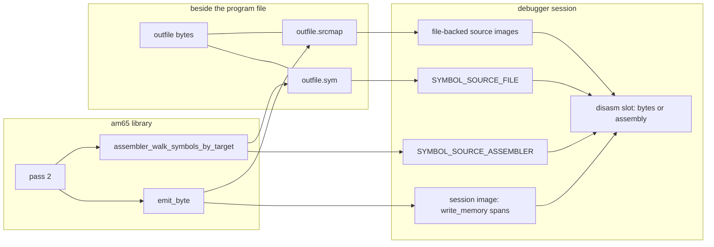

# Debugger symbol files and source maps for am65

| Field | Value |
|-------|-------|
| Status | **landed** |
| Author | Stefan Wessels |
| Date | 2026-10-09 |
| Audience | am65 implementers; a2m/c64m debugger owners |
| Product scope | Shared `src/shell/tools/am65/`, `src/shell/tools/symbols/`, `src/shell/tools/disasm_6502/`, `src/shell/frontend/` disasm slot; both runtime assemblers |
| Intended permanent path | `design/am65/debugger-symbols-and-source-maps.md` |
| Index status | **landed** in `design/README.md` |

## Overview

Programs that cannot be assembled straight into machine memory (two executables plus a chooser, written to HostFS, run later from the emulated disk) already have an offline symbol listing (`am65 -s`) and a live symbol import. The listing is the format the debugger already loads. What is missing is equates in that listing, one loadable file per output target so two programs at the same origin do not share one address slot, and any source-level view of the bytes just assembled.

This design is one program in three sequenced increments. Increment 1 makes per-target `.sym` files that the existing Symbol Files path can load, including equates, and writes the same file beside an in-emulator host-file target. Increment 2 records a pass-2 source map inside the assembler and shows it as a mode of the existing disassembly slot, for the session that just assembled. Increment 3 writes that map beside the `.sym` and loads the sibling when the symbol file is loaded, so a later session can step the same program from source. Increment 2 is useful for assemble-into-memory before any sidecar map exists. Increment 1 is useful for HostFS before any source view exists.

The section "Follow-on: source maps and integrated debugging" in `design/am65/layout-assertions-and-tooling.md` is still what `design/README.md` indexes. It is not marked historical. It still says the source-map design must settle macro lines, include paths, coalescing, and replacement, and the recommended delivery order still lists "Address-to-source map data model" as item 3. This document is the one to implement. PR 1 lands this file, adds an **active** index row, and replaces that follow-on section with a short pointer here. The assertions work and the other follow-ons in that file stay. Those two files are not edited until that PR.

## Background & Motivation

### What the assembler writes today

`dump_symbol` in `src/shell/tools/am65/main.c` writes `"%04X  %s\n"`. `dump_segments` then appends a `SEGMENTS` block, one stanza per `TARGET`, addressed as half-open `[start, output)`. The CLI flag is `-s <symfile|->` (`main` reads a single path; `"-"` is stdout). That path is one `FILE`, not one file per target. Named outputs are `FILE_TARGET.file_name`, set for `-o` on the default target and for `.scope name file=` / `prg=` via `cli_target_open`. A dest-only scope has a null `file_name` and `sink` pointing at the parent image. `write_target_file` skips a target with no `file_name` or with `wrote_any` clear.

`assembler_walk_symbols` (`src/shell/tools/am65/asm.c`) walks `root_scope` and child scopes. The name it passes is `Scope::name` for every nested scope (`assembler_walk_scope_symbols` appends `scope_name`, then `"::"`). It emits only `SYMBOL_ADDRESS` and skips macro locals whose name is `__macro_local_` and whose length is `GEN_NAME_LEN` (18). Equates are `SYMBOL_VARIABLE` (`parse_variable` on `name = expr`) and are omitted. Anonymous labels (`:` / `:-`) are pushed onto `as->anon_symbols` in `parse_label` and are not symbols.

### What the debugger loads today

`symbol_table_load_file` (`src/shell/tools/symbols/symbol_file.c`) accepts a token of exactly four hex digits, optional `$` or `0x` prefix, then whitespace, then one label token. Anything else is skipped, including the `SEGMENTS` block for ordinary segment names (the address sits inside `[C000-C015)`, not as a whitespace-delimited token). So `C00D  done` loads. `done C00D` does not. `symbols/c64/kernal.txt` and `symbols/apple2/APPLE2E.SYM` are address-then-name. That is the real format.

The help text says the opposite. `src/apple2/app_options.c` describes `--symbols` as "NAME hex per line". `manual/a2m/manual.md` repeats that. `a2m.ini.example` says "NAME hex per line files". c64 has no `--symbols` flag (`src/c64/app_options.c` does not register one). `c64m.ini.example` does not document column order. Both manuals describe `-s` only as "a symbol + segment listing".

`symbol_table_add(..., overwrite=false)` returns `SYMBOL_CONFLICT` when `primary_by_address[address]` is already set (`src/shell/tools/symbols/symbol_table.c`). The loader ignores every result except `SYMBOL_OUT_OF_MEMORY` and still increments `loaded`, so the second label is not stored but counts as loaded. `primary_by_address` is rebuilt from enabled sources only (`symbol_rebuild_indexes` skips a source that is not enabled). One primary label per address among enabled sources, across files. Duplicate names at different addresses are allowed (`test_symbol_file_allows_duplicate_names` in `tests/c64/tools/test_symbol_table.c`). There is no Apple symbol-table harness; apple2 tests do not call `symbol_table_*`.

`symbol_resolver_address_to_label` prints `display_name`, the leaf after the last `::` (`symbol_split_name`). The disasm address column then forces `address_label[15] = '\0'` (`disasm_pane_draw`). A stored token `chooser::start` displays as `start`.

### What a successful assemble does to the table

Both runtime assemblers, on `assembler_assemble == ASM_OK`, call `symbol_table_remove_kind(symbols, SYMBOL_SOURCE_ASSEMBLER)` and then `assembler_walk_symbols` with `overwrite=true`:

- Apple: `runtime_assembler_import_symbol` from `runtime_assemble_file_legacy_ex` (`src/apple2/runtime/runtime_assembler.c`). `runtime_assemble_file_ex_options` is the entry `runtime_assemble_file_command` calls.
- C64: the same pair inside `c64_assemble_file_ex` (`src/c64/runtime/runtime_assembler.c`).

`overwrite=true` goes through `symbol_remove_address_conflicts`, which deletes every record at that address, any source kind. File targets still import. The next successful assemble wipes every assembler-sourced symbol, including one imported under a different source name. `tests/c64/runtime/test_runtime_assembler.c` locks that: `STALE` and `OLD_STALE` disappear, builtin `CHROUT` stays, and a nested label is stored as `Inner::target`. `SYMBOL_SOURCE_FILE` entries from Symbol Files stay, because `runtime_load_symbol_files` is a separate path: it `symbol_table_remove_kind(..., SYMBOL_SOURCE_FILE)` and reloads the comma-separated `symbol_files` list (`src/apple2/runtime/runtime_thread.c` and `src/c64/runtime/runtime_thread.c`). Soft-disable is per source (`symbol_table_set_source_enabled_at`, UI in `symbol_lookup_view`). This design does not change that UI.

Host file bytes are flushed only after a successful assemble, from `runtime_assembler_flush_files`, which walks `targets` starting at index 1 (index 0 is the host-owned default target). A target with `write_file` and `file_path` is written by `runtime_assembler_flush_file_target`. The path is resolved beside the assembled source by `runtime_assembler_resolve_output_path`. The default target always has `write_memory` and no file (`default_target.write_memory = true` in both `runtime_assembler.c` files). A file-only `.scope` sets `write_memory` from `dest=` and does not poke RAM. `file=` plus `dest=` does both. The CLI target has no `write_memory`; dest-only scopes sink into the parent image.

### What disasm already resolves

`format_absolute_operand` in `src/shell/tools/disasm_6502/disasm_6502.c` substitutes a label for absolute, absolute-X, absolute-Y, indirect, absolute-indirect-X, and relative. Relative computes `address + 2 + (int8_t)operand` and then uses the same helper (`tests/shell/tools/test_disasm_6502.c` expects `BNE $0FFE`). Zero-page, zp-indexed, `(zp,X)`, `(zp),Y`, and `(zp)` print `$xx` and do not consult symbols. Mnemonics are uppercase (`LDA`, `JSR`, `BNE`).

The disasm slot is one rectangle of `debugger_layout` (`src/shell/frontend/debugger_layout.h`): Display, registers, disassembly, memory, Misc. `disasm_pane_draw` owns follow-PC for the byte listing. `follow_pc` starts true. While running, or when follow is on and the PC row is not centered, the pane calls `disasm_pane_lock_pc` and rewrites `top_address` before any row is drawn (`disasm_pane.c`, the `has_cpu` block). Wheel, scrollbar, and click set `follow_pc` false. The live key table is the product twin `frontend_disassembly_handle_key` in `src/apple2/frontend/frontend.c` and `src/c64/frontend/frontend.c`, not `debugger_disasm_handle_key` (nothing calls it). Right arrow calls `frontend_disassembly_follow_pc`, which writes `pc_lock_address`, `top_address`, `pc_lock_active`, and `follow_pc` on `frontend_disassembly_view_state`. The pane struct is a stack local rebuilt every frame from that view state; fields that must survive a frame are copied in and out of `frontend_draw_disassembly_view`. Keys run on the view state before `disasm_pane_draw`. There is no disasm-pane test. `tests/shell/frontend/test_disasm_pc_lock.c` tests `disasm_pc_lock_build` without Nuklear. `tests/shell/tools/test_disasm_6502.c` tests the decoder.

Apple's disasm context menu draws memory banks through `frontend_context_menu_source_modes` (heading "Source", then Map / Main / Aux / LC1 / LC2 / ROM). That helper exists only in `src/apple2/frontend/frontend.c`. C64's `frontend_disasm_draw_context` inlines the heading "Source" and the items Map / ROM / RAM. "Source" in both menus is the memory bank, not a source listing.

### Where a source map has to be recorded

`emit_byte` (`src/shell/tools/am65/emit.c`) already has the address, `as->pass`, and `segment->do_not_emit`. It calls `output_byte` only when `pass == 2` and the segment emits, then advances `segment_output_address` either way. `ASM_FILE.buf` and `display_name` live until `files_free`, which `assembler_program_state_destroy` calls from `assembler_shutdown`. Copy `ASM_FILE.display_name` as stored; do not call `realpath` again. `load_file_into_array` stores an `asm_strdup` of the path `file_resolve_path` returned. `canonicalize_path` returns `realpath` (or `_fullpath` on Windows) when that succeeds, otherwise a copy of the path it was called with. For a relative include, `file_resolve_path` calls `join_current_dir_path`, which canonicalizes the joined directory plus the relative path. If `realpath` fails, the stored string is that joined path, not the include token from the source. `FILE_FRAME.is_macro` is set by `file_stack_push` from `parse_macro_if_is_macro`. The caller frame stays underneath with `line_num` still on the call line, because `file_read_line` has already consumed that line and the macro frame is what subsequent reads advance. `as->line` at that point is the macro body after `macro_substitute_line` and `define_substitute`, and `strip_comment` has already cut `;` comments. The original text is only in `ASM_FILE.buf`.

`file_read_line` breaks on `\n`, on `\r\n` (both bytes, one line), and on a bare `\r`. It then increments `FILE_FRAME.line_num`. The bytes copied into `as->line` exclude the break.

`asm_err` always logs `ASM_SEVERITY_ERROR` (`src/shell/tools/am65/err.c`). `asm_warn` logs `ASM_ERR_WARNING` at `ASM_SEVERITY_WARNING`. `errlog_error_count` ignores warning severity, and `assembler_assemble` returns `ASM_ERR` when that count grows. On pass 2, `asm_log` drops `ASM_ERR_DEFINE` and keeps `ASM_ERR_RESOLVE`. `print_diagnostics` and `runtime_assembler_append_warnings` select on `ASM_SEVERITY_WARNING`. A warning and an error are not interchangeable.

### What the UI copies from the runtime

`runtime_symbol_slot` (`src/apple2/runtime/runtime_internal.h`, and the c64 twin) is `mutex`, `runtime_symbol_snapshot snapshot`, and `has_symbols`. `runtime_publish_symbols` fills the snapshot under the mutex and sets `has_symbols`. `runtime_client_poll_symbols` returns false, without writing `out`, when `has_symbols` is clear; on success it copies the snapshot and clears the flag. That success test does not read `asm_source_publish`. `RUNTIME_SYMBOL_SNAPSHOT_MAX` is 4096, the name cap is 64, and the source-name cap is 1024. It is not a place for file text, and the symbol snapshot is not copied every frame.

Apple `main.c` comments the idle path as mutex-plus-flag only. When the control port is active, `control_dispatch_poll_symbols` (`cache_symbols_from_client` in `src/apple2/control/control_dispatch.c`) consumes `has_symbols`, and the UI reads symbols only when that returns true, via `control_dispatch_copy_symbols`. Otherwise the UI calls `runtime_client_poll_symbols` and updates symbols only when that returns true. Those two branches are alternate consumers of `has_symbols`. C64 has one symbol consumer, `poll_symbols_into` in `src/c64/main.c`, which fans out to `frontend_update_symbols` and the control cache only inside that same success test. A second symbol poll on C64 would steal the handoff. The source generation is not part of that handoff: both Apple branches and `poll_symbols_into` read it every UI frame even when the symbol poll returns false.

## Goals

1. A symbol file the existing loader accepts, one per output file the user will run, including address labels and equates, without a new syntax.
2. An in-emulator host-file assemble writes that `.sym` beside the program so a later assemble and a later session can load it as `SYMBOL_SOURCE_FILE`.
3. Help and both am65 manual sections say address then name.
4. After a successful assemble, the disassembly slot can show the source that emitted the byte under the PC, including `.include` and macro call sites, without a new pane.
5. The same map can be saved and loaded beside the symbol file for a later session.
6. Identical assembler behavior in standalone am65, a2m, and c64m.

## Non-Goals

- A new symbol-file syntax.
- Keeping two overlay programs live in one address slot, or turning `SYMBOL_CONFLICT` into "keep both and swap on enable".
- Zero-page operand substitution. An equate at `$00FD` shows in the address column when the PC is on that byte. It does not rewrite `LDA $FD`.
- Source breakpoints, source-line stepping, an editor, syntax highlighting, or a file picker.
- Rewriting the disassembly mnemonic column as source text.
- Marking `.string` ranges as data in the disasm pane. Instruction stepping and address breakpoints stay as they are.
- Changing assertion, `.error`, or `.warning` behavior.
- Implementing `.struct`, sliced `.incbin`, or depfiles.
- Redesigning Symbol Files, Configure, or `symbol_lookup_view`.
- Sandboxing assembler output paths beyond the paths the assembler already writes.
- Matching the disasm pane's memory bank (Apple Map / Main / Aux / LC / ROM, C64 Map / ROM / RAM) when choosing a source span. The session predicate is `write_memory`.

## Key Decisions

1. **Emit the loader's format. Do not invent one.** Lines are four uppercase hex digits, two spaces, one name token (`"%04X  %s\n"`, which `dump_symbol` already writes). The `SEGMENTS` block stays. The loader keeps skipping non-matching lines. Today's label lines from `-s` already load. The gaps are equates, one file per target, address collisions, the session wipe, and help text that describes the columns backwards.

2. **Emit `SYMBOL_ADDRESS` and `SYMBOL_VARIABLE`. Still skip macro locals.** `print = $ffd` becomes a symbol at `$0FFD`, so an absolute `JSR` displays `JSR print`. Anonymous labels stay out of the table because they are not symbols. The shared walker is what live import uses, so assemble-into-memory gains equates too. The wipe, `SYMBOL_SOURCE_ASSEMBLER`, and `overwrite=true` stay. There is no equate-vs-counter flag: `.for` / `.repeat` counters and `++` / `--` variables are also `SYMBOL_VARIABLE` and will be emitted at their final pass-2 value, truncated to `uint16_t` by the existing callback. That is accepted. Do not add a symbol kind to filter them.

3. **One symbol file per output file. Do not merge overlay programs.** Two programs at the same origin must not be loaded as one table. The user loads the file for the program they are about to run. `SYMBOL_CONFLICT` continues to drop the second label. No multi-resident overlay table in this program.

4. **`-s` is the trigger. One user path is the combined dump. Per-target files are only the sidecars.** Today's `-s` is one `FILE` for the whole assembly. When `N <= 1`, `<path>` and stdout are that full walk: every symbol, every target's `SEGMENTS`, including no-path and dest-only symbols. Per-target filtering applies only to `<file_name>.sym` sidecars (`N >= 2`, and the in-emulator host file). `-s` absent writes nothing. The matrix below is the rule. Do not treat `N == 1` as a filtered sidecar that happens to use the user's path.

5. **In-emulator host-file output writes `<file_path>.sym` in that same format.** Live import stays, including the wipe on the next successful assemble. File-backed symbols are how the chooser survives that wipe and a later process. The memory-only default target does not grow a sidecar.

6. **Fix the texts that describe column order. Do not document a new format.** a2m `--symbols`, the a2m manual flag table, `a2m.ini.example`, and the `-s` section of both manuals. Do not add a c64 `--symbols` flag. c64 has none.

7. **Zero-page operand substitution stays out.** Covered as a non-goal. Relative and absolute operands already resolve; zp modes do not.

8. **The map is a pass-2 library result, recorded in `emit_byte`, only for bytes actually emitted.** Not frontend code inside the assembler. One record per contiguous run of one source line, not per byte. Non-emitting lines (`* =`, equates, blanks) have no span and never take the PC mark, but they stay visible because the view draws the snapshotted file.

9. **The view is a mode of the disassembly slot.** Layout stays Display | CPU | disasm | memory | Misc. No sixth pane. Plain text, no markup, no coloring, no editor. Gutter address is `span.start`, only on lines that emitted. While the mode is on and `follow_pc` is true, center the source viewport on the PC line every frame, paused or running, until a paused scroll or click clears follow. Running forces follow and ignores that input. One file of one image on screen. The view records whether that image is the session image or which loaded file map, plus the file index. `.include` switches files only when follow lands in another file or another image. Text comes from the snapshot, never a later disk read.

10. **Macro spans record the call site in the user file, not the body line.** The walk is specified below. Nested macros attribute to the nearest non-macro frame. The stored line text uses `file_read_line`'s break rules, not a newline count.

11. **A successful assemble with a clear recording flag replaces the in-session snapshot wholesale.** Same lifetime idea as `symbol_table_remove_kind(SYMBOL_SOURCE_ASSEMBLER)`. No merge by address, no stale tail from a shorter rebuild. A failed assemble leaves the previous snapshot. A recording failure also leaves it: the flag below is the signal, not the warning log, because `.warning` shares that log. File-backed maps from increment 3 are not wiped by that replace.

12. **A source mark means the last memory-writing emit placed this line here.** Session PC lookup is the last matching span in emit order among spans whose target wrote machine memory (`assembler_output_target.write_memory`). File-only spans stay out of that image and are reached through that output's `.srcmap`. A later `* =` that rewrites an address wins over the earlier line. The gutter prints `span.start`, not the PC. The lookup returns the owning image with the span. If memory is overwritten by something other than this assemble, byte disasm shows the new bytes and the source view still shows the assembled line. Addresses the assembler did not emit (ROM, a loaded program, a poke) have no line.

13. **The source map is a separate file. Its name replaces a trailing `.sym`, ASCII case-insensitive.** `prog.bin.sym` becomes `prog.bin.srcmap`. `listing.sym` becomes `listing.srcmap`. `FOO.SYM` becomes `FOO.srcmap`. A path that does not end in `.sym` still appends `.srcmap` (`listing.txt` becomes `listing.txt.srcmap`). Do not concatenate (`prog.bin.sym.srcmap` is the wrong name). Do not append source records to `.sym`. A source line can contain four hex digits and `symbol_file_parse_line` would accept it. `-s` writes both sidecars when the matrix says to. Loading a `.sym` looks beside itself for `.srcmap`, ignores a missing one, and does not import map lines as symbols. No second Configure control.

14. **Stepping stays instruction stepping. Breakpoints stay address breakpoints.** Do not rewrite disasm rows into source text. Do not teach the disasm pane that a span is data.

## Proposed Design



### Increment 1 — loadable per-target symbol files

#### Line format

Unchanged from `dump_symbol`:

```text
0FFD  print
C00D  done
C00E  name

SEGMENTS -> prog.bin {
  CODE [C000-C015)
}
```

Names keep the walk's prefix (`chooser::start`). The disasm shows the leaf. Do not strip the redirect scope's name; one naming function, and `symbol_split_name` already displays the leaf. Hash-bucket order stays (`HASH_BUCKETS` is 64, `name_hash & HASH_MASK`). Tests look symbols up by name, not by file order.

The `SEGMENTS` block for a normal name is not a symbol line. Residual: a segment whose name is exactly four hex digits becomes a token the loader accepts (`  ABCD [C000-C010)` loads a symbol `ABCD` at `$ABCD` with label `[C000-C010)`). Real segment names are not four hex digits. Do not change the loader or the block to chase that.

Names of 128 bytes or more are omitted by the existing loader. `symbol_file_parse_line` continues when `label_length >= out_label_size`, and the loader's buffer is `SYMBOL_FILE_LABEL_MAX` (128) in `src/shell/tools/symbols/symbol_file.c`. Do not raise the cap in this program. Tests stay on short names. The walk builds names in a 512-byte buffer (`assembler_walk_scope_symbols`). `assembler_symbol_append` refuses a name that does not fit and the walk skips it, so a name is written and then silently dropped on load only when its length is 128 through 511.

#### Which symbols

Change the filter in `assembler_walk_scope_symbols` from "skip unless `SYMBOL_ADDRESS`" to "skip macro locals and anything that is neither `SYMBOL_ADDRESS` nor `SYMBOL_VARIABLE`". Macro-local detection stays `assembler_symbol_is_macro_local`. Also skip `SYMBOL_LOCAL` and `SYMBOL_UNKNOWN` if any remain at walk time. `.define` text is a `DEFINE`, not a symbol, and stays out.

`assembler_symbol_cb` stays as it is so live import's call site does not grow a target argument it ignores. Add a second walk for sidecar partitioning:

```c
typedef void (*assembler_symbol_target_cb)(
    const char *name,
    uint16_t address,
    TARGET *target,
    void *user);

void assembler_walk_symbols_by_target(
    ASSEMBLER *as,
    assembler_symbol_target_cb cb,
    void *user);
```

`assembler_walk_symbols` becomes the same recursion with the target discarded, so there is one filter. Owning target, evaluated at the scope that holds the symbol (the scope `symbol_write` used, which is the scope the walk is visiting):

```c
static TARGET *symbol_owning_target(SCOPE *scope, TARGET *default_target) {
    for (; scope != NULL; scope = scope->parent_scope) {
        if (scope->has_output_redirect && scope->output_target != NULL) {
            return scope->output_target;
        }
    }
    return default_target;
}
```

`default_target` is `targets[0]`. A nested `.proc` or nameless `.scope` does not redirect, so it inherits the ancestor redirect. That matches where the bytes went: `dot_scope` sets `active_target` for the whole body, and `dot_endscope` restores `output_target->parent`.

The host, not the library, turns a `TARGET *` into a path. The library does not know `FILE_TARGET` or `assembler_output_target`.

- CLI: `FILE_TARGET *ft = target->ctx`, then `sink = ft->sink ? ft->sink : ft`. The sidecar owner is `sink->file_name` when non-NULL. A dest-only scope sinks into the parent image, so its symbols belong to the parent file.
- Runtime: `assembler_output_target *ot = target->ctx`. The sidecar owner is `ot->file_path` when `ot->write_file` is set. A dest-only scope has `write_file` false; its symbols are live-imported and not written to a sibling file. The two hosts really differ here. Do not invent a shared sink pointer on the runtime target.

Per-target sidecars omit symbols whose target has no output path, and they omit equates on a `file=` target that did not write bytes (`wrote_any` clear, so that target is not in `N`). Those symbols still appear in the `N <= 1` combined dump, in a combined stdout listing, and in live import.

#### CLI `-s` rule

Let a **file target** be a `FILE_TARGET` that is its own sink (`sink == self`), has a non-NULL `file_name`, and has `wrote_any` set. Dest-only nodes and targets that emitted nothing are not file targets. `N` is that count. `main` already writes binaries only when `assembler_assemble` returned `ASM_OK`. The symbol path for `N <= 1` is not a sidecar: it is today's combined dump.

| `-s` | `N` | Symbols | Source map (increment 3) |
|------|-----|---------|--------------------------|
| absent | any | nothing | nothing |
| `-` | `N <= 1` | combined dump on stdout: every symbol the walk yields, every target's `SEGMENTS`, including no-path and dest-only symbols. Same as today, even if assemble failed | none. There is no symbol path |
| `<path>` | `N <= 1` | that path gets the same combined dump, even if assemble failed (today's `main` writes `-s` after a failed assemble) | sibling of `<path>`, only when `assembler_assemble` returned `ASM_OK`, `source_map_record_failed` is clear, and the symbol file was created. Do not also require the binary write |
| `-` | `N >= 2` | stdout gets the same combined dump. Also `<file_name>.sym` per file target, sidecars only if assemble succeeded and that binary was written | `<file_name>.srcmap` beside each sidecar that was written, and only when the recording flag is clear |
| `<path>` not `-` | `N >= 2` | do not create `<path>`. Write `<file_name>.sym` per file target only if assemble succeeded and that binary was written. Print one stderr line whenever `-s` was given a non-`-` path, including when assemble failed and no sidecar was written | matching `.srcmap` only for sidecars that were written, and only when the recording flag is clear |

The stderr line is exactly:

```text
-s <path> ignored; wrote symbol sidecars beside N output files
```

`N` is the file-target count defined above. The line is not an assemble error and does not by itself change the exit code. It is printed even when the assemble failed and the "wrote" half did not create files. Binary write failures still set the exit code, as `write_target_file` does today.

Per-target filtering applies only to `<file_name>.sym` sidecars and to the spans in those sidecars' `.srcmap` files. Each sidecar's `SEGMENTS` block is that target only, same line shape as `dump_segments`. The combined dump's `SEGMENTS` block is every target, as `dump_segments` writes today.

`<file_name>.sym` is the output path plus the suffix `.sym` (`prog.bin` becomes `prog.bin.sym`, `prog.prg` becomes `prog.prg.sym`). It is not "replace the extension". The `.srcmap` name is Decision 13 applied to that symbol path, so `prog.bin.sym` becomes `prog.bin.srcmap`.

#### In-emulator host file

After `runtime_assembler_flush_file_target` writes the binary, write `<file_path>.sym` for that target's symbols (owning-target filter above). In increment 3, also write the `.srcmap` from Decision 13 (`<file_path>.sym` becomes `<file_path>.srcmap`). Both products. The Apple body is `runtime_assemble_file_legacy_ex`. The C64 body is `c64_assemble_file_ex`. Write the `.sym` only when the binary write returned success. Write the `.srcmap` only when that `.sym` was written and `source_map_record_failed` is clear. The default memory target gets no sidecar. A file-only scope's spans are not part of the session image; the user reaches them by loading that `.sym`, which loads the sibling map.

Live import stays a full `assembler_walk_symbols` with `overwrite=true` after `symbol_table_remove_kind(SYMBOL_SOURCE_ASSEMBLER)`. Equates join that import because the filter change is shared. A second assemble still deletes them. Loading the `.sym` later publishes them as `SYMBOL_SOURCE_FILE`, which the wipe does not touch. Live import is gated on `ASM_OK` only. It does not consult `source_map_record_failed`.

#### Help text

| Location | Change |
|----------|--------|
| `src/apple2/app_options.c` `--symbols` help | "hex address then name per line" |
| `manual/a2m/manual.md` `--symbols` row | same, address then name |
| `a2m.ini.example` `symbol_files` comment | same |
| `manual/a2m/manual.md` and `manual/c64m/manual.md` `-s` row and the paragraph under the am65 switch table | address then name, four hex digits, one token; `SEGMENTS` is not loaded; equates included; per-target rule above |
| `src/c64/app_options.c`, `c64m.ini.example` | no column-order claim today; leave them |

`manual/*/manual.md` is ASCII-only. `src/shell/tools/gen_help.py` fails the build on non-ASCII. Do not edit `HELP_MARKDOWN.md` by hand; it is generated.

#### Worked symbol file

Source, exactly:

```asm
* = $C000

print = $ffd

ldx #0
: lda name, x
beq done
jsr print
inx
bne :-
done: rts

name: .string "stefan", $00
```

Bytes, which the symbol addresses are tied to:

| Address | Bytes | Line |
|---------|-------|------|
| `$C000` | `A2 00` | `ldx #0` |
| `$C002` | `BD 0E C0` | `: lda name, x` |
| `$C005` | `F0 06` | `beq done` (`$C005+2+6 = $C00D`) |
| `$C007` | `20 FD 0F` | `jsr print` |
| `$C00A` | `E8` | `inx` |
| `$C00B` | `D0 F5` | `bne :-` (`$C00B+2+(-11) = $C002`) |
| `$C00D` | `60` | `done: rts` |
| `$C00E`..`$C014` | `73 74 65 66 61 6E 00` | `.string "stefan", $00` |

The symbol file contains `print` at `0FFD`, `done` at `C00D`, and `name` at `C00E`. It does not contain the anonymous label at `$C002`. `$ffd` is `$0FFD` because the walker casts `symbol_value` to `uint16_t` and `dump_symbol` prints `%04X`.

After load, `disasm_6502_decode_line` shows `LDA name,X`, `BEQ done`, `JSR print`. `BNE` targets `$C002`, which has no symbol, so the operand stays `BNE $C002` (`format_absolute_operand` falls through to `"$%04X"`). The address column at `$C00D` shows `done` and at `$C00E` shows `name`, via `address_to_label`. The prompt's lowercase "disassembly shows" is the source text, not the decoder. The decoder is uppercase. The `BNE` does not become `BNE done`; `done` is a different address.

#### Tests for increment 1

- Extend `tests/c64/tools/test_symbol_table.c` only. Do not add `tests/apple2/tools/test_symbol_table.c`. Add: `C00D  done` loads; `done C00D` does not; a `SEGMENTS` stanza does not load; two labels at one address return `SYMBOL_OK` from the loader, `loaded == 2`, and `symbol_table_find_by_address` returns the first stored name only. Keep the new names short. Do not add a 128-byte-label case that would require raising `SYMBOL_FILE_LABEL_MAX`.
- Mirror a new assembler test the way `tests/apple2/tools/test_assembler_assertions.c` and `tests/c64/tools/test_assembler_assertions.c` mirror each other (product `test_file.h`, `a2m_test_write_temp_file` / `c64m_test_write_temp_file`, registered next to `assembler_assertions` in `src/apple2/CMakeLists.txt` and `src/c64/CMakeLists.txt`). Drive `assembler_walk_symbols` on the worked example: the three names and addresses above, no fourth name, and the bytes in the output callback.
- On the existing target harness (`tests/apple2/tools/test_assembler_targets.c` and the c64 twin), two `.scope file=` programs at the same origin partition through `assembler_walk_symbols_by_target`. Each target sees its own label. A dest-only CLI-style sink is covered by a host whose `target_open` records the parent, if that case is cheap beside the file= test; the runtime dest-only case is "no sidecar", asserted from `tests/apple2/runtime/test_runtime_assembler.c` and `tests/c64/runtime/test_runtime_assembler.c`, which already assemble `file=` / `dest=`.
- Those runtime tests also assert `<file_path>.sym` contents for the file-only scope and that a following assemble still removes `SYMBOL_SOURCE_ASSEMBLER` while a loaded file symbol remains. Loading the sidecar is `symbol_table_load_file` in the c64 symbol test, not a second parser.
- CLI: `N <= 1` with `-s <path>` writes the combined dump, including an equate whose `file=` target has `wrote_any` clear. `N >= 2` with `-s <path>` does not create `<path>`, writes one `.sym` per file target that wrote bytes, and prints the stderr line even when `assembler_assemble` returns `ASM_ERR` and no sidecar is written.

### Increment 2 — in-session source map and source view

#### Recording

`assembler_assemble` assigns `as->pass = 2` twice. The first assignment only serves `evaluate_assertions` and does not emit. Clear the span list and `source_map_record_failed` at the second assignment, immediately before `assembler_run_pass`. Add the flag on `ASSEMBLER` next to `explicit_error`:

```c
/* Set when pass-2 source-map recording could not store a span.
   Cleared immediately before assembler_run_pass. assembler_assemble
   can still return ASM_OK. Hosts must not publish a session image
   or write a .srcmap while this is set. */
int source_map_record_failed;
```

In `emit_byte`, in the same branch that calls `output_byte` (`pass == 2`, segment present, `!segment->do_not_emit`, address `<= 0xFFFF`), append or extend a span. Pass 1, noemit, reclaim, and the "address exceeds 64K" error path record nothing. Auto-adjust retries pass 1 only, so they do not append spans.

Each span:

| Field | Meaning |
|-------|---------|
| `start` | `uint32_t` inclusive address of the first byte of this run |
| `end` | `uint32_t` exclusive. A line that emits the byte at `$FFFF` stores `end == 0x10000`. `uint16_t` cannot say that; segment extents already use this |
| `file` | `ASM_FILE *` of the user-visible frame |
| `line` | 1-based line number, the same counter `file_read_line` stores in `FILE_FRAME.line_num` and diagnostics print |
| `target_index` | `active_target_index(as)` at the emit. Sidecar partitioning in increment 3 uses it. The published session image drops spans whose runtime target has `write_memory` false |

Coalesce: if the last span has the same file, line, and target index, and `last->end == address`, set `last->end = address + 1`. `.string` is one `emit_byte` per character and becomes one span `[C00E, C015)`. A `.repeat` that emits the same line at contiguous addresses also becomes one span. A second emission of that line at a non-contiguous address is a second span. A later `* =` that rewrites an address already spanned appends another span; it does not edit the earlier one. A few thousand lines is the expected program: one span per emitting line, not per byte. The snapshot holds the file text `file_load` already read. Do not copy the line into the span; slice it from `ASM_FILE.buf` at publish time.

Allocation failure while recording does not fail the assemble. The bytes are already the product: `output_byte` has run, and a runtime `write_memory` target has already poked RAM. Do not call `asm_err`. That always logs `ASM_SEVERITY_ERROR`, `errlog_error_count` counts it, and `assembler_assemble` then returns `ASM_ERR`, which skips symbol import and host-file flush. Do not use `ASM_ERR_DEFINE` (dropped on pass 2) or `ASM_ERR_RESOLVE` (kept, and it fails the build). Call `asm_warn`, which is what `print_diagnostics` and `runtime_assembler_append_warnings` already select:

```c
as->source_map_record_failed = 1;
asm_warn(as, "source map recording failed; emitted bytes kept, session map unchanged");
```

Set the flag on the first failure and stop appending. Before `assembler_assemble` returns, if the flag is set, free the partial span list so a caller that only checks `ASM_OK` cannot install it. The warning alone is not the publish signal: `.warning` and truncated values share `ASM_SEVERITY_WARNING`. Both hosts publish a session image, and increment 3 writes a `.srcmap`, only when `assembler_assemble` returned `ASM_OK` and `source_map_record_failed` is clear. Otherwise discard the partial list and leave the previously published session image unchanged. Bytes already emitted stay emitted.

A successful assemble that emitted no bytes leaves the flag clear and an empty span list. That is a real replace: publish an image with `file_count == 0`. It is not a recording failure.

#### Call-site walk

`as->current_line` during a macro body is the body line (`file_stack_push` of the macro sets `line_num` to `macro->body_line`, which `dot_macro` captured as the `.macro` line, and the next `file_read_line` increments onto the body). That is the wrong line to display. The caller is still on the stack:

```c
static void source_loc(const ASSEMBLER *as, ASM_FILE **out_file, size_t *out_line) {
    size_t i;
    const FILE_FRAME *fallback = NULL;

    for (i = as->file_stack.items; i > 0; i--) {
        const FILE_FRAME *frame =
            AM65_ARRAY_GET((AM65_DYNARRAY *)&as->file_stack, FILE_FRAME, i - 1);
        if (frame->is_macro) {
            if (fallback == NULL) {
                fallback = frame;
            }
            continue;
        }
        *out_file = frame->file;
        *out_line = frame->line_num;
        return;
    }
    /* Expansion is always pushed above a caller. This is only a bad stack. */
    *out_file = fallback != NULL ? fallback->file : as->current_file;
    *out_line = fallback != NULL ? fallback->line_num : as->current_line;
}
```

Why this is the call site: `parse_macro_if_is_macro` runs from `parse_line` of the caller's already-read line, then pushes `is_macro=1`. The caller's `line_num` is not incremented again until the macro frame is popped and the caller reads another line. The loop starts at the top, skips every macro frame, and stops at the nearest `is_macro == 0` frame. An `.include` that calls a macro records the include file and the call line in that include, not the root line that included it. A macro body that calls another macro skips both macro frames and records the outermost user line, not the inner call and not the body. Do not use `as->line`.

Slice the stored row from that frame's `file->buf` with the same breaks as `file_read_line`: `\r\n` is one line, `\n` is one line, and a bare `\r` is one line. Lines are 1-based, matching `line_num`. The stored row is the bytes between breaks and excludes the break. Do not count `\n` only. A `\n` count treats `\r\n` as one line but leaves the `\r` on the text, and it treats a `\r`-only file as a single line while `line_num` advances per `\r`.

`.repeat` / `.for` do not push a file frame. `restore_loop_body` rewinds `read_ptr` and `line_num` on the current frame. Those emits record the loop body line, which is the line the user is reading. That is correct.

#### Publish before `files_free`

`assembler_shutdown` destroys `ASM_FILE.buf`. Copy before that call, and only when assemble returned `ASM_OK` and `source_map_record_failed` is clear. In the runtime, `assembler_shutdown` runs inside `runtime_assemble_file_legacy_ex` and `c64_assemble_file_ex` before those functions return, and neither takes a `runtime_symbol_slot`. The body builds the heap image and returns it. The thread installs it later, beside `runtime_publish_symbols`. The CLI owns its `ASSEMBLER` in `main` and copies there before its own shutdown.

```c
typedef struct asm_source_file {
    char *display_name; /* copy of ASM_FILE.display_name as stored */
    char *text;         /* copy of buf, size bytes, plus a trailing NUL for C */
    size_t size;        /* byte count of the file text, not including the NUL */
} asm_source_file;

typedef struct asm_source_span {
    uint32_t start;
    uint32_t end;
    uint32_t file_index;
    uint32_t line;         /* 1-based */
    uint32_t target_index;
} asm_source_span;

typedef struct asm_source_image {
    asm_source_file *files;
    size_t file_count;
    asm_source_span *spans;
    size_t span_count;
} asm_source_image;

typedef struct asm_source_hit {
    const asm_source_image *image; /* NULL if none */
    const asm_source_span *span;   /* NULL if none */
} asm_source_hit;
```

Copy every `ASM_FILE` that has at least one span the image is keeping (full text, not just emitting lines). Non-emitting lines in that file stay visible. Remap `ASM_FILE *` to `file_index`. The library can expose `assembler_source_span_count` / `assembler_source_span_at` and the existing `as->files` array; the copy helper lives next to them in `src/shell/tools/am65/` so CLI and both runtimes share it. Pointers in the image are owned by the image. Free the previous published image, then install the new one. Do not append.

The session image the runtime publishes keeps a span only when that span's target wrote machine memory. On both runtime targets, `assembler_output_target.write_memory` is the predicate: true for the default target and for a scope with `dest=`, false for a file-only `.scope file=`. The library records every emitting span; the runtime copy drops `write_memory == false` before install. Do not also filter by the disasm pane's current memory bank. File-only spans remain on the assembler's span list until shutdown so increment 3 can write them into that output's `.srcmap`. They are not installed in the session image. A session that only emitted file-only bytes publishes `file_count == 0`.

The CLI has no `write_memory` and no session image. Its `.srcmap` is specified in increment 3.

On the runtime thread, the published images sit on `runtime_symbol_slot` under the slot mutex that already guards `has_symbols`. Do not put file text in `runtime_symbol_snapshot`. Do not clear the image when `runtime_client_poll_symbols` clears `has_symbols`.

```c
typedef struct asm_source_publish {
    asm_source_image *session;     /* NULL if none. Not cleared on symbol poll. */
    asm_source_image **file_maps;  /* load order. Not cleared on symbol poll. */
    size_t file_map_count;
    uint32_t generation;           /* 0 means no session image and no file map */
} asm_source_publish;
```

Add `asm_source_publish source` to `runtime_symbol_slot` in both `runtime_internal.h` files (or a heap pointer to that struct, same mutex). Bump `generation` when the session image is replaced and when the file-map list is replaced. `runtime_client_poll_symbols` still only moves the symbol snapshot. It does not read, clear, or free `source`.

`runtime_assemble_file_ex_options` (both products) gains `asm_source_image **out_session`, forwarded into `runtime_assemble_file_legacy_ex` and `c64_assemble_file_ex`. Callers that do not want an image pass NULL. Before `assembler_shutdown` in those two bodies:

- `ASM_OK` and `source_map_record_failed` clear: `*out_session` is the session image, including a real image with `file_count == 0` when nothing memory-writing was emitted. `write_memory == false` spans are already dropped.
- Otherwise `*out_session` is NULL. The partial span list is already discarded. Do not install from inside the assembler body. Those functions do not take a `runtime_symbol_slot`.

The caller owns `*out_session`. Install only a non-NULL image, under the slot mutex, in the same command path that already calls `runtime_publish_symbols` after a successful assemble:

- Apple: `runtime_assemble_file_command` in `src/apple2/runtime/runtime_thread.c` (the `RUNTIME_COMMAND_ASSEMBLE_FILE` arm calls it, then it calls `runtime_publish_symbols`).
- C64: both success paths that call `runtime_publish_symbols` after assemble. `runtime_assemble_file_command` is the no-reset path. `runtime_complete_pending_asm` is the reset-to-BASIC path. A NULL out-pointer on either path leaves the previously installed session image in place.

`RUNTIME_COMMAND_SET_SYMBOL_SOURCE_ENABLED` also calls `runtime_publish_symbols` and must not replace the session image or bump `source.generation`.

`runtime_load_symbol_files` in both `runtime_thread.c` files builds the file-map list, installs it under the slot mutex, bumps `generation`, and does not touch the session image. It already calls `runtime_publish_symbols` after the file loop. The generation bump is independent of that symbol publish.

```c
/* Locks slot->mutex. Does not read or clear has_symbols.
   Does not free slot->source.
   *inout_generation is the caller's last-copied asm_source_publish.generation.
   It lives beside the symbol poll buffer in apple2/main.c and in
   poll_symbols_into. It is not view->source_generation. Do not pass
   &view->source_generation: that would clear the draw's mismatch before
   the initial-file rule runs.
   The only counter is asm_source_publish.generation. asm_source_image has
   no generation member.
   When slot->source.generation != *inout_generation, free the previous
   images in *out, deep-copy session and every file map (new file text,
   not aliased pointers), set out->generation to the slot generation, and
   set *inout_generation to that same value. Returns true when it copied. */
bool runtime_client_copy_source_if_changed(
    runtime_client *client,
    asm_source_publish *out,
    uint32_t *inout_generation);
```

Call that helper every UI frame, even when the symbol poll returns false. The caller's `*inout_generation` starts at 0 next to the existing durable symbol buffer (`symbol_poll_buf` in `apple2/main.c`, the static snapshot in `poll_symbols_into`). The `asm_source_publish *out` is that same caller's durable publish. The poll site then hands `out` to the frontend for drawing. It does not write `frontend_disassembly_view_state.source_generation`.

- `src/apple2/main.c`, on both the `control_active` branch and the direct `runtime_client_poll_symbols` branch. `cache_symbols_from_client` is not the reader. It must not clear or free `source`.
- `poll_symbols_into` in `src/c64/main.c`, outside the `if (runtime_client_poll_symbols(...))` success test. Do not add a second symbol poll.

The draw reads that UI copy. Comparing `file_index` across the slot and the copy is meaningless; follow uses the copy's `session` pointer and `file_maps[]`. A null publish is `asm_source_publish.generation` 0, the empty state. Reading the slot generation every frame makes the order versus `has_symbols` irrelevant: a bump after the UI has already consumed the symbol flag is still visible on the next frame. The draw's own `source_generation` is a third value, updated only after the initial-file rule, specified below.

Failed assemble: the body returns false before the thread reaches `runtime_publish_symbols`, and `*out_session` is NULL. Do not replace the image. Recording failure with `ASM_OK`: import and flush still run inside the body; `*out_session` is NULL; the command still publishes symbols and does not replace the session image.

#### Lookup and the slot

Pure functions, no Nuklear, so they can be tested the way `disasm_pc_lock` is tested:

```c
/* Last span in emit order with start <= pc < end.
   Search the session image first. It contains only write_memory spans.
   A session hit does not consult file maps.
   Otherwise search file_maps in load order. The first map that contains
   a covering span wins, and within that map the last span in emit order
   wins. A later * = rewrite inside one image beats the earlier span.
   file_index is per image, so the hit names the image. */
asm_source_hit asm_source_span_at_pc(
    const asm_source_image *session,
    const asm_source_image *const *file_maps,
    size_t file_map_count,
    uint16_t pc);

/* Gutter address for (file, line) inside one image: span.start of the span
   containing prefer_pc if one does, otherwise span.start of the span with
   the lowest start. 0 if the line has no span. *has_span distinguishes
   "address 0" from "no span". Never returns the PC itself. */
uint16_t asm_source_line_gutter(
    const asm_source_image *image,
    uint32_t file_index,
    uint32_t line,
    uint16_t prefer_pc,
    int *has_span);
```

`start` fits in `uint16_t` because `emit_byte` only records addresses `<= 0xFFFF`. `end` may be `0x10000` and is not what the gutter prints. Linear scan. A few thousand spans per redraw is noise next to the disasm decode. Do not add an interval tree.

Two file maps that both cover `pc` resolve to the earlier map in load order, then the last span inside it. That matches symbol load, which keeps the first label. It does not let a later unrelated `.srcmap` hide an earlier one. Session still wins on every address the memory-writing assemble actually emitted.

Row text, column 7 for the source, matching the worked view:

- Empty source line: an empty row.
- Otherwise `"%s %c %s"` where the address field is `"    "` or `"%04X"` of `span.start`, the mark is `'>'` or `' '`, and the rest is the stored row with the break excluded.
- `'>'` only on the line whose span contains the PC. A PC in the middle of `JSR` (`$C008`) still marks `jsr print` and the gutter is `C007`, because the span is `[C007, C00A)` and the gutter is `span.start`, not the PC.
- Non-emitting lines use four spaces and a space mark. The PC never sits on them.

Worked view with the PC at `$C007` (source bytes of the listing above, snapshot line numbers 1 and 3 have no gutter). The same gutter addresses are drawn when the PC is `$C008`:

```text
       * = $C000

       print = $ffd

C000   ldx #0
C002   : lda name, x
C005   beq done
C007 > jsr print
C00A   inx
C00B   bne :-
C00D   done: rts

C00E   name: .string "stefan", $00
```

The mode flag is `assembly_mode` on `frontend_disassembly_view_state`, duplicated in both `frontend.c` files. The pane is rebuilt from that struct every frame, and `frontend_disassembly_handle_key` runs before `disasm_pane_draw`, so a flag that exists only on `disasm_pane_state` does not survive and is not what the key handler toggles. `cursor_row` on that struct is a `uint8_t` screen row for the byte listing. A source cursor does not fit there, and a stack local in the assembly draw dies the next frame. Also on that view state:

```c
enum {
    ASM_SOURCE_VIEW_NONE = 0,    /* empty state; no image */
    ASM_SOURCE_VIEW_SESSION = 1, /* the UI copy's session image */
    ASM_SOURCE_VIEW_FILE = 2     /* file_maps[source_map_index], load order */
};

bool assembly_mode;
uint32_t source_top_line;     /* first visible source row while the mode is on */
uint32_t source_view_which;   /* ASM_SOURCE_VIEW_* */
uint32_t source_map_index;    /* load-order index; only when WHICH is FILE */
uint32_t source_file_index;   /* file inside that image */
uint32_t source_cursor_line;  /* 1-based line in that file; 0 means no cursor */
uint32_t source_generation;   /* UI copy's asm_source_publish.generation after the initial-file rule last ran. Starts at 0. The poll helper does not write this. */
```

`source_file_index` alone cannot name the image. Session `files[0]` and the first loaded map's `files[0]` are both index 0, and a session image with `file_count == 0` is still non-NULL. `follow_pc` stays the existing shared field. Do not store the source cursor in `cursor_address` or `cursor_row`. Do not compare `source_generation` to `*inout_generation` or to a field on `asm_source_image`. The draw compares it to the UI copy's `asm_source_publish.generation`.

The Nuklear window name stays `"Disassembly"` so the window id does not move. When `assembly_mode` is on, `frontend_draw_disassembly_view` does not call `disasm_pane_draw`. That function's `has_cpu` block calls `disasm_pane_lock_pc`, may call `disasm_pane_decode`, and writes `top_address` before any row is drawn. A mode branch placed after that block would move the byte listing. While the mode is on, do not call `disasm_pane_lock_pc`, do not decode bytes, and do not write `top_address`, `pc_lock_address`, or `pc_lock_active`. Right-click still opens `frontend_disasm_draw_context` from the assembly-mode draw.

The context-menu item is `Assembly`, not `Source`. Add it after the existing source-mode items in both `frontend_disasm_draw_context` implementations. Apple draws those items through `frontend_context_menu_source_modes`. C64 does not have that helper; it inlines Map / ROM / RAM under the "Source" heading. Do not call the Apple helper from C64. The item toggles `assembly_mode`. It does not change `source_id` or the memory bank.

`frontend_disassembly_handle_key` in both `frontend.c` files returns immediately when `runtime_state` is `FRONTEND_RUNTIME_STATE_RUNNING`, before any key is examined. Alt+O therefore runs only while paused. The byte-listing Alt+B test is the first key test after that return: `alt && sym == SDLK_b` calls `frontend_disassembly_ensure_user_cursor` and `frontend_toggle_execute_breakpoint_at_cursor` on `cursor_address`. While `assembly_mode` is on, that arm must own Alt+B and return without those two calls.

Toggle, both products, in `frontend_disassembly_handle_key`, only while the disasm view is active:

- The running return stays first and applies in both modes. While running, navigation keys never reach the assembly arms.
- **Alt+O** (no shift), after the running return and in a branch that still runs when `assembly_mode` is on. `SDLK_o` is not used by either `main.c` or either disasm/memory key table. Alt+S is Symbol Lookup, Alt+M cycles memory source, Alt+A is address entry, Alt+R is Forensics, Alt+H is help.
- **Alt+B** while `assembly_mode` is on uses `source_cursor_line`. If that line has a span in the image named by `source_view_which` / `source_map_index` / `source_file_index`, toggle an execute breakpoint at that span's `start` (still an address breakpoint). No span, or `source_cursor_line == 0`: do nothing. Do not read `cursor_address`.
- **Alt+Left** while `assembly_mode` is on is handled before `frontend_disassembly_ensure_user_cursor` and before the byte `SDLK_LEFT` arm, which sets PC from `cursor_address`. Paused, and not inspecting: set PC to the span start of `source_cursor_line`. No span, or time travel: no-op, as today. Do not write `top_address`.
- Entering the mode does not clear `follow_pc` and does not change `top_address` of the byte listing. Leaving restores byte disasm with the follow flag and `top_address` as they are. The frame the mode is entered still has `follow_pc` true (it starts true), so that frame's draw centers.
- While paused in the mode: wheel, scrollbar, and click set `follow_pc` false. Click sets `source_cursor_line` to the clicked 1-based source line and does not write the machine PC or `cursor_address`. Up and Down, when they move the selection, change `source_cursor_line` by one line, clear `follow_pc`, and do not call `frontend_disassembly_set_user_cursor`. Page scrolls `source_top_line` by the visible row count, clears `follow_pc`, and does not change `source_cursor_line`. Right arrow sets `follow_pc` true and returns. It does not call `frontend_disassembly_follow_pc` and does not itself write `source_top_line`; the draw centers because follow is now true.
- While running, the assembly draw forces `follow_pc` true before it handles input, and it ignores wheel, scrollbar, click, and navigation keys. That matches the pane's wheel guard (`!running` in `disasm_pane_draw`) and the key handler's early return. A same-frame wheel must not clear follow after the running recenter.
- While `assembly_mode` is on and `follow_pc` is true, every frame, paused or running: if the PC hit's image is not the image on screen, or `hit->span->file_index` differs from `source_file_index`, write `source_view_which`, `source_map_index`, and `source_file_index` from the hit. Then set `source_cursor_line` to that span's line and center `source_top_line` on it (`line` minus half the visible rows, clamped at 0). A PC in no span leaves the image, the file, `source_top_line`, and `source_cursor_line` as they are and draws no `>`. This includes the frame the mode is entered and the frame a generation mismatch applies the initial-file rule.
- A paused step with `follow_pc` already false stays detached. Do not recenter on `pc_changed`. `disasm_pane_draw` does call `disasm_pane_lock_pc` on `pc_changed` before it consults `follow_pc`. Assembly mode skips that call and does not grow a replacement.
- Follow switches when the hit image is not the image on screen or the file index differs. The image on screen is `source_view_which` plus `source_map_index`, compared with the UI copy (`session` versus `file_maps[i]`), not with `source_file_index` alone. There is no file picker. Detached scrolling keeps `source_view_which`, `source_map_index`, and `source_file_index` even if the PC moves into another image or an include.
- No UI copy, or every image has `file_count == 0`: `source_view_which` is `ASM_SOURCE_VIEW_NONE` and the draw is one line, `No assembly source`. A session image with `file_count == 0` is not a file on screen. A root source that only `.include`s has no span and is not `files[0]`. There is no separate "root file" rule.
- Initial file, when `source_generation` does not match the UI copy's `asm_source_publish.generation`: the session file that contains the PC span (`ASM_SOURCE_VIEW_SESSION` and that `file_index`), else `files[0]` of the session image when `file_count > 0`, else `files[0]` of the first file map with `file_count > 0` (`ASM_SOURCE_VIEW_FILE` and that `source_map_index`), else `ASM_SOURCE_VIEW_NONE`. The rule writes which, map index, and file index together.
- On that generation mismatch, set `source_top_line` to 0 and `source_cursor_line` to 0 only when `follow_pc` is false. When `follow_pc` is true, the same frame then applies the follow rule above, which centers on the PC line instead of leaving the viewport at 0. After that rule and that same-frame follow, set `source_generation` to the UI copy's `generation`. The rule then does not run again until the poll helper stores a newer `out->generation`. Leaving `source_generation` unchanged would zero a detached scroll every later frame. Writing it from `runtime_client_copy_source_if_changed` would skip the rule entirely.
- Snapshot or file map present, PC in no span: draw the current image and file (or the initial file if this generation has not been shown) with no `>`.

Centering never writes `top_address`, `pc_lock_address`, or `pc_lock_active`.

Byte disasm is untouched when the mode is off. Spans do not change `disasm_6502_decode_line`.

#### Tests for increment 2

Mirrored assembler tests (same pair as increment 1, or a second mirrored pair `test_assembler_source_map.c` if the symbol file is already large):

- Worked example: eight spans, the address ranges in the table above, no span for `* =` or `print =`, no span for the anonymous label as a symbol (the `:` line does have a span because it emitted `LDA`).
- `.include`: a byte emitted from the include records the include's `display_name` as stored and that file's line, not the root line of the `.include` directive.
- Macro: a body that emits two instructions records one coalesced span (or two, if they are separated) whose file and line are the call site in the non-macro file. Assert the line number is the call, not the `.macro` body. A nested macro call still records the outer user line.
- Next to that macro test, a `\r\n` fixture: the call line is bounded by `\r\n`, and the stored row equals the call text with no `\r` and no `\n`. A `\r`-only file records one row per `\r`. This keeps the slice and `file_read_line` from drifting.
- Noemit: a `do_not_emit` segment produces no span. The label in that segment can still appear in the symbol walk.
- Replace: assemble a longer program, copy the image, assemble a shorter one, copy again. The second image has no span whose address exists only in the first. This is a host-level check of "free then install", plus a library check that the emitting pass 2 starts from an empty span list. `runtime_assemble_file_ex_options` with a non-NULL `out_session` returns an image only when the body got `ASM_OK` and the recording flag is clear, and returns NULL otherwise. Existing callers, including the current runtime assembler tests, pass NULL. A NULL out-pointer leaves the previously installed session image unchanged.
- Last match: two emits cover the same address (a later `* =` rewrite). `asm_source_span_at_pc` returns the later span. The gutter address is that span's `start`, so prefer-PC `$C008` on the worked example yields `$C007`, not `$C008`.
- Runtime publish filter: a file-only scope (`write_memory` false; the existing runtime assembler tests already assemble one) contributes no span to the session image. Its spans are still available to the `.srcmap` writer in increment 3.
- `asm_source_span_at_pc` / gutter: a shell test under `tests/shell/tools/` or `tests/shell/frontend/` next to `test_disasm_pc_lock.c`. PC at `$C007` and `$C008` both hit the `jsr` line and the hit's image. PC at `$C000` hits `ldx`. PC at `$C015` (one past the string) hits nothing (`image` and `span` both NULL). A session span hides a file map at the same address. A PC the session does not cover falls through to the first file map that does. Do not promise a `disasm_pane_draw` test. Nothing in `tests/shell/frontend/` builds a Nuklear context for that pane.

### Increment 3 — persist the map beside the symbol file

#### Name and trigger

Same trigger rows as the symbol matrix. The map path is Decision 13 applied to the symbol path, not a second derivation from the binary and not a concatenation:

- If the symbol path ends in `.sym` under ASCII case-insensitive compare, replace that suffix with `.srcmap` (`prog.bin.sym` becomes `prog.bin.srcmap`, `listing.sym` becomes `listing.srcmap`, `FOO.SYM` becomes `FOO.srcmap`).
- Otherwise append `.srcmap` (`listing.txt` becomes `listing.txt.srcmap`).

Compare the suffix by lowercasing `A`–`Z` only. Do not use a locale case fold.

`N <= 1` and `-s -` write no map: there is no symbol path. `N <= 1` and `-s <path>` write the sibling only when `assembler_assemble` returned `ASM_OK`, `source_map_record_failed` is clear, and the symbol file was created. A failed `write_target_file` after `ASM_OK` still leaves today's `-s` write in place; that path still gets a sibling map. Do not also require the binary write for this row.

`N >= 2` writes `<file_name>.srcmap` only beside a `<file_name>.sym` that was actually written (assemble succeeded and that binary was written) and only when the recording flag is clear. The stderr line for an ignored `<path>` is printed whenever `-s` was given a non-`-` path, including when assemble failed and no sidecar was written.

The `N <= 1` map is the combined span list: every emitting span, every file those spans reference, full text. It is not filtered to one file target. Per-target filtering applies only to `<file_name>.sym` sidecars and their maps. A sidecar map contains only spans whose `target_index` resolves to that output file (same host path rule as symbols), and only the files those spans reference, full text included. Two targets in one source file duplicate that file's text into both sidecar maps and carry different spans. A few thousand lines makes that acceptable. Loading a map does not call `symbol_table_add`.

In-emulator host files use the same suffix rule: `<file_path>.sym` becomes `<file_path>.srcmap`. Copy `display_name` as stored into the map. Do not call `realpath` again while writing or loading.

#### On-disk format

One text header line, then counted records. A source line is never parsed by `symbol_table_load_file` because this file is not passed to that function. `ASM_FILE.buf` is raw (`file_load` uses `"rb"`) and need not end in a newline. Path bytes and text bytes are adjacent. No newline is inserted after either blob.

```text
AM65SRCMAP 1\n
FILE <index> <path-byte-length> <text-byte-length>\n
<exactly path-byte-length bytes of display_name, no NUL added>
<exactly text-byte-length bytes of the snapshot text>
FILE ...
SPAN <file-index> <line> <start-hex> <end-hex>\n
```

After the header line, every `FILE` record comes before any `SPAN` line. A `FILE` record is one text line ending in `\n`, then exactly `path-byte-length` bytes, then exactly `text-byte-length` bytes, with no separator between the blobs and no separator after the text. The next byte is the start of the next `FILE` line or the first `SPAN` line. A reader that stays line-oriented through the blobs will disagree with this layout as soon as a source file does not end in `\n`. Switch to a counted read after each `FILE` line.

- The header is the exact line `AM65SRCMAP 1` plus `\n`, no extra tokens. Compare the whole line, not a prefix. `AM65SRCMAP 10` is rejected.
- `index` is decimal, dense from 0 in order, matching `file_index`. One `FILE` record per index.
- Path and text lengths are decimal byte counts. The path is `ASM_FILE.display_name` as stored, no added NUL, no re-canonicalization at load. Identity inside one image is that string compared with `strcmp`. Drawing does not open the path. The embedded text is what the gutter lines up against, so a later edit on disk cannot shift it. `size` on the in-memory file is `text-byte-length`. The trailing NUL the C struct keeps is not written.
- `line` is decimal, 1-based.
- `start` is exactly four hex digits. `end` is one to five hex digits, half-open, `10000` when the span includes `$FFFF`.
- Span lines are uppercase hex, matching the symbol listing. Order is emit order.
- No `SEGMENTS` block in this file.
- The file ends after the last `SPAN` line's `\n`. No trailing junk.

Reject the file, publish nothing, and do not half-apply, when any of these is true:

- the first line is not exactly `AM65SRCMAP 1`
- a length exceeds the remaining bytes, or the file ends inside a blob or a line
- total file text exceeds 8 MiB
- span count exceeds 65536
- a `FILE` index is not the next dense index in `0 .. file_count-1` (gap, duplicate, or out of order)
- a `SPAN` file index is not in `0 .. file_count-1`
- `end < start` or `end > 0x10000`
- any byte remains after the last well-formed `SPAN` line

A missing or malformed sibling is silent. Do not call `runtime_publish_error`. The caps exist so a corrupt sibling cannot allocate without bound. They are not a threat model.

#### Load trigger

`runtime_load_symbol_files` already runs on the runtime thread in both products when the process starts and when Configure applies `symbol_files`. After `symbol_table_load_file` returns `SYMBOL_OK` for path `P`, derive the sibling with Decision 13 and try to open it.

- Missing file, or `fopen` failure: ignore. Do not call `runtime_publish_error`. A missing symbol file does publish `failed to load symbol file`; a missing map must not, because most symbol files (`kernal.txt`, `APPLE2E.SYM`) will never have a sibling.
- Present but rejected by the rules above: ignore the same way. Do not half-apply. Leave the previous file-map list as this function's wholesale replace defines it: the function drops the previous file maps at the start, alongside `symbol_table_remove_kind(SYMBOL_SOURCE_FILE)`, then installs one image per sibling that loaded, in symbol-path order. A rejected sibling contributes no image. Do not touch the in-session image.
- Accepted: that image is one entry in the replacement list. Bump `asm_source_publish.generation` once the list is installed. Do not clear it on the next symbol poll.

Lookup is `asm_source_span_at_pc`: last memory-writing session span, else the first loaded file map that covers the PC, last span inside that map. The hit's `image` is the one whose `files[]` the view draws. `file_index` is not comparable across images. A fresh assemble-into-memory wins on addresses its `write_memory` spans cover, including over a `.srcmap` loaded earlier. Addresses it did not emit, and file-only spans that were never installed in the session image, fall through to a loaded `.srcmap`. That is how a chooser loaded from Symbol Files still has a source mark after a later, unrelated assemble into memory that did not emit those addresses. The session replace does not free file-backed images.

Empty state: generation 0, or no session image and no file-backed image, or every image has `file_count == 0`. Draw `No assembly source`. If only file maps exist, the initial file is `files[0]` of the first map with `file_count > 0`, and the view draws no mark until the PC hits a span.

#### Tests for increment 3

- Round-trip the worked example through the writer and reader: file text byte-identical, including a fixture whose text does not end in `\n` and whose path and text blobs are adjacent, span bounds identical, `display_name` identical to the stored string.
- Suffix examples: `prog.bin.sym` to `prog.bin.srcmap`, `listing.sym` to `listing.srcmap`, `FOO.SYM` to `FOO.srcmap`, `listing.txt` to `listing.txt.srcmap`.
- Reject, with no partial image: `AM65SRCMAP 10`, a `SPAN` file index outside `0 .. file_count-1`, a non-dense `FILE` index, `end < start`, `end > 0x10000`, and trailing junk.
- A `.sym` whose sibling is absent loads symbols and leaves the file-map list empty. No error string.
- A `.srcmap` loaded alone is not a symbol import: `symbol_table_count` does not grow because of it. The test calls the map loader, not `symbol_table_load_file`, on that path.
- `N <= 1` writes the sibling map when assemble returned `ASM_OK` and the symbol file was created, even if `write_target_file` failed. It does not write the map when assemble returned `ASM_ERR`. `N >= 2` prints the stderr line when `-s <path>` was given and assemble failed.
- Session replace leaves a previously loaded file map in place. PC lookup hits the later session span when both claim the same address, and the file map when the session does not cover it. A file-only span is absent from the session hit and present in that output's `.srcmap`.

## API / Interface Changes

Library (`src/shell/tools/am65/asm.h`, `emit.c`, new `source_map.h` or fields on `ASSEMBLER`):

- `assembler_walk_symbols` starts yielding `SYMBOL_VARIABLE` as well as `SYMBOL_ADDRESS`. Callers: CLI `dump_symbol`, both `runtime_assembler_import_symbol`. No signature change.
- `assembler_walk_symbols_by_target` added. CLI and both flush paths use it for sidecars.
- `source_map_record_failed` on `ASSEMBLER`, cleared immediately before the emitting `assembler_run_pass`. Set from `emit_byte` on allocation failure together with `asm_warn`. Partial spans freed before `assembler_assemble` returns when the flag is set.
- Span list on `ASSEMBLER`, cleared at that same point, filled from `emit_byte`. Read API as above. No callback into the frontend.

Symbol table: no API change. `symbol_table_load_file` stays best-effort and address-then-name. `SYMBOL_CONFLICT` stays a drop. `SYMBOL_FILE_LABEL_MAX` stays 128.

Runtime, both products:

- After a successful host-file flush, write `<file_path>.sym`. Write `<file_path>.srcmap` only when that `.sym` was written and the recording flag is clear.
- `runtime_symbol_slot` gains `asm_source_publish` under the existing mutex. `runtime_client_poll_symbols` does not read, clear, or free it. `runtime_client_copy_source_if_changed` compares `asm_source_publish.generation` only. On a difference it frees the previous images in the caller's `*out`, deep-copies, and sets `out->generation` and `*inout_generation` to the slot generation. It does not free `slot->source`. `*inout_generation` stays in `apple2/main.c` and `poll_symbols_into`, not in `source_generation`.
- `runtime_assemble_file_ex_options` gains `asm_source_image **out_session`. The body (`runtime_assemble_file_legacy_ex`, `c64_assemble_file_ex`) fills it before `assembler_shutdown`. Existing callers pass NULL.
- Apple `runtime_assemble_file_command` installs a non-NULL session image and bumps `generation` next to its `runtime_publish_symbols`. C64 does the same in `runtime_assemble_file_command` and in `runtime_complete_pending_asm`. `SET_SYMBOL_SOURCE_ENABLED` publishes symbols and does not touch `source`.
- Every UI frame, both Apple branches in `apple2/main.c` and C64 `poll_symbols_into` call the copy helper even when the symbol poll returns false. `cache_symbols_from_client` is not that reader.
- `runtime_load_symbol_files` loads the sibling map with Decision 13 and the reject rules above. It replaces the file-map list, bumps `generation`, and does not touch the session image.

Frontend, both products:

- `frontend_disassembly_view_state` gains `assembly_mode`, `source_top_line`, `source_view_which`, `source_map_index`, `source_file_index`, `source_cursor_line`, and `source_generation`. Both `frontend.c` copies. Not `cursor_row`.
- When `assembly_mode` is set, `frontend_draw_disassembly_view` does not call `disasm_pane_draw` and does not write `top_address`. Follow true centers `source_top_line` every frame, paused or running. Running forces follow and ignores detach input.
- `frontend_disassembly_handle_key` gains Alt+O. The assembly arm owns Alt+B, Alt+Left, click, and Up/Down through `source_cursor_line`. Right arrow only sets `follow_pc`.
- `frontend_disasm_draw_context` gains `Assembly` after the existing source-mode items. Apple keeps `frontend_context_menu_source_modes` for the banks. C64 keeps its inlined Map / ROM / RAM items.
- Manuals and `a2m.ini.example` and a2m `--symbols` help, as in the table above.

Disasm decoder: no change. Zero-page modes stay numeric. Relative stays `format_absolute_operand`.

## Data Model Changes

No symbol-table schema change. The on-disk symbol format is the one `symbol_file_parse_line` already implements. New on-disk artifact is `.srcmap` only, specified above, never mixed into `.sym`.

In memory, `asm_source_publish` is process-local on `runtime_symbol_slot`. It is not in the INI, not in a snapshot of the emulated machine, and not in `runtime_symbol_snapshot`. Machine savestates do not grow a field. A restarted process gets file-backed maps back only by loading symbol files again, which already happens at startup from `symbol_files`. The generation is not a savestate field. Poll does not consume it.

Migration: none. Old emulators ignore extra files beside a program. New emulators load old `.sym` files as they do today. A `.sym` written with equates is still address-then-name, so an older loader that has not taken increment 1's walker change still loads it if the file was produced by a newer am65. The walker change and the loader are independent.

## Alternatives Considered

### New symbol format versus address-then-name

A format with an explicit kind column (`L` / `E`), quoted names, or `name = $addr` would record equates without overloading them as labels and would let the `SEGMENTS` block be structured. It would also refuse to load in `symbol_table_load_file`, disagree with `kernal.txt` and `APPLE2E.SYM`, and make the help-text bug look like the spec. The user belief that `-s` cannot be loaded is already false for label lines. Cost of the existing format: one primary label per address, equates indistinguishable from labels at load, loop counters emitted as addresses, four-hex segment names as a footgun, and names of 128 bytes or more dropped by the loader. Those are acceptable because the debugger's resolver is address-to-leaf-name and the user loads one program at a time. Reject a new format. Do not raise the label cap to paper over the last of those.

### One combined sidecar versus `.sym` plus `.srcmap`

Appending spans or file text to `.sym` would be one file to copy and one Configure entry. `symbol_file_parse_line` scans every line for a four-digit hex token and would import source lines (`C00D  done` inside a listing, or a span line `SPAN 0 11 C00D C00E`) as symbols. Quoting or indenting every source line to dodge the parser is a new format hiding inside the old file, and a single corrupted quote would pollute the symbol table. Two files cost a sibling `fopen` that already has a defined miss (silent). The symbol loader stays untouched. Reject the combined file.

### A sixth layout pane versus a mode of the disassembly slot

A permanent source pane would show bytes and source together and would not steal the disasm key table. `debugger_layout` is a fixed five-rectangle split (`display`, `registers`, `disassembly`, `memory`, `misc`) with drag handles wired in both products and in the manual. A sixth pane is a layout migration, two more splitters, and a new focus stop in the Alt+Tab cycle. The user looks at one PC at a time. A mode reuses `follow_pc`, the slot bounds, and the context menu. The cost is that bytes and source are not on screen together; Alt+O is one key. Reject a new pane.

### Re-read the `.asm` from disk versus snapshot `ASM_FILE.buf`

Re-reading would show the user's latest edits and would avoid storing file text in the session and in `.srcmap`. It would also move the gutter as soon as a line is inserted, which is the bug the snapshot exists to prevent, and it would fail for an include path that was valid at assemble time and is gone later, and for macro call sites whose displayed line is not "whatever is on disk at the body". `ASM_FILE.buf` is already the text pass 2 used, held until `files_free`. Copying it is the same bytes the assembler saw. Disk is not consulted when drawing. Reject re-reading.

### Record the macro body line versus the call site

Body lines are what `asm_err` prints, and they are unique per instruction inside the macro, so a PC could sit on `lda` inside the template rather than on one call line that covers every expansion. The file the user is reading does not contain the expansion as separate lines unless they open the macro definition, and `FILE_FRAME.is_macro` is exactly the signal that the current line is not that file. Recording the body would either show a file the user did not step into, or show the definition while the PC is in one call among several, with no call-site address. The nearest non-macro frame is already on the stack and its `line_num` is still the call. Nested macros would otherwise light up an intermediate body the user never wrote in the file on screen. Reject body-line recording. The cost, accepted, is that a multi-instruction macro is one gutter address (the start of the coalesced run, `span.start`) on the call line.

## Security & Privacy Considerations

These files are local debug artifacts. The assembler already writes program bytes to the path the user gave it: CLI `fopen` of `-o` and of `.scope file=` / `prg=` (`write_target_file`), and both runtimes' `runtime_assembler_flush_file_target` of `assembler_output_target.file_path`. The symbol sidecar is that same path plus `.sym`, or the `-s` path the user passed. The map sidecar is Decision 13 applied to that symbol path (a trailing `.sym` replaced, ASCII case-insensitive, otherwise `.srcmap` appended). Relative emulator `file=` paths resolve beside the source (`runtime_assembler_resolve_output_path`). CLI paths are cwd-relative, as today. There is no network, no new privilege, and no path sandbox. A source file could already direct the assembler to write a binary anywhere the process can write; the sidecar uses that path. `.srcmap` embeds the assembled source text, which the user asked to assemble. Do not treat that as a secret store. The loader caps a sibling at 8 MiB of text and 65536 spans, rejects a malformed framing, and otherwise ignores it.

Symbol files and maps are not uploaded, not written into the INI (the INI already stores the symbol path list only), and not put in machine savestates.

## Observability

Assembly warnings and errors already go through `ERRORLOG`. The CLI prints them in `print_diagnostics`. The runtime puts errors on `RUNTIME_EVENT_ASSEMBLE_ERROR` and warnings on the assemble notice (`runtime_assembler_append_warnings`). Both of those warning paths select `ASM_SEVERITY_WARNING`.

A source-map allocation failure calls `asm_warn` with `source map recording failed; emitted bytes kept, session map unchanged` and sets `source_map_record_failed`. It does not call `asm_err`, so `assembler_assemble` can still return `ASM_OK`, symbol import still runs, and host-file flush still runs. The previously published session image stays. The partial span list is freed inside `assembler_assemble` before return. Bytes already emitted stay emitted. Hosts do not infer this from "the log contains a warning". They read the flag.

A missing `.srcmap` is silent. No `runtime_publish_error`. A present but malformed `.srcmap` is silent and unused. No half-applied image.

A symbol conflict on load stays the current silent drop: `symbol_table_load_file` does not log `SYMBOL_CONFLICT`, increments `loaded`, and keeps the first label. This program does not add a diagnostic for it. Names of 128 bytes or more stay a silent skip. This program does not add a diagnostic for that either.

The one new CLI message is the stderr line when `N >= 2` and `-s` was given a path other than `-`, including when assemble failed and no sidecar was written. It is not an assemble error and does not change the exit code by itself. Binary write failures still set the exit code, as `write_target_file` does today.

No new metric and no new alert. This is a local debugger, not a service.

## Rollout Plan

No feature flag. Three changes land on `master` in order, each runnable without the later ones. `agents/README.md` says to prefer `master` and not to create a branch unless asked. Durable rules move into `agents/` when the work lands; this design stays in `design/am65/` and is not copied into `agents/`.

1. Symbol sidecars, equates, help text, tests, and the design-index pointer in PR 1. Users load `<outfile>.sym` with the Symbol Files control that already exists. Byte disasm starts resolving absolute equates. Rollback is revert. Leftover `.sym` files remain valid listings.
2. In-session map and Alt+O. Useful for assemble-into-memory with no sidecar. Rollback removes the mode; byte disasm is the default, so a half-landed UI that fails to compile does not ship. The session image is not persistent.
3. `.srcmap` write and sibling load. Older builds ignore the extra file. Newer builds tolerate a missing sibling. Rollback leaves orphan `.srcmap` files that nothing reads.

No data migration. No INI version bump. Savestates unchanged.

## Risks

| Risk | Severity | Mitigation |
|------|----------|------------|
| Live import uses `overwrite=true`, which deletes every record at that address, not only assembler records. Emitting equates makes a final loop-counter value or an equate able to remove a builtin at that address. A label at that address already could. | Medium | Documented. Do not special-case equates. Users who need the builtin label do not equate over it. File-backed `.sym` uses `overwrite=false` and will not evict an existing primary; the new label is the one dropped. |
| Walk order is hash buckets, so two `SYMBOL_VARIABLE` / labels at one address in one file: the loader keeps whichever line comes first, and `loaded` counts both. | Low | Tests assert by name and address, not line order. One primary stays the rule. |
| Four-hex-digit segment names in the `SEGMENTS` block load as symbols. | Low | Unchanged block. Not this program's format change. |
| Scoped names in the file (`chooser::start`) surprise someone reading the sidecar, even though the pane shows `start`. | Low | Manual says the token is the walk name and the disasm shows the leaf. Do not strip prefixes. |
| The stored `display_name` is often a machine-specific absolute path. `realpath` / `_fullpath` supplies it when that succeeds. For a relative include whose `realpath` fails, the stored string is the joined directory plus the relative path, not the include token. | Low | Copy `ASM_FILE.display_name` as stored. Drawing uses embedded text. Do not call `realpath` again and do not open the path. |
| Alt+O is easy to forget, and the byte listing and the source are mutually exclusive. Entering the mode through `disasm_pane_draw`'s lock block would also move `top_address`. | Low | Context menu item `Assembly` after the existing bank items. `assembly_mode` lives on `frontend_disassembly_view_state`. The assembly draw does not call `disasm_pane_draw`. Window id stays `Disassembly`. |
| Putting the source image in the symbol snapshot, or reading `source.generation` only inside the `has_symbols` success test, drops it. `runtime_client_poll_symbols` returns false without touching `source`. Apple's two branches and C64 `poll_symbols_into` update symbols only on that success. `runtime_publish_symbols` is a separate critical section. | Medium | Build the heap image before `assembler_shutdown`. Install and bump `generation` beside the assemble publish (`runtime_assemble_file_command` on Apple; that function and `runtime_complete_pending_asm` on C64) and in `runtime_load_symbol_files`. Every UI frame, both Apple branches and `poll_symbols_into` call `runtime_client_copy_source_if_changed` even when the symbol poll returns false. The copy does not free `source`. |
| A recording failure that is only a warning gets published anyway, because other warnings share the log. An `asm_err` instead fails the assemble after bytes were already emitted and skips symbol import and host-file flush. | Medium | `asm_warn` plus `source_map_record_failed`. Publish and `.srcmap` write require `ASM_OK` and a clear flag. The partial list is freed before return. Emitted bytes stay. |
| First-match session lookup keeps a file-only span, or an earlier `* =` line, in front of the bytes the machine is running. | Medium | Session image omits `write_memory == false`. Lookup is last match in emit order. The hit names the image. Gutter is `span.start`. |
| Twin edits miss one product (`frontend_disassembly_handle_key`, `runtime_load_symbol_files`, flush, the symbol-slot publish). C64 assembles from two functions. | Medium | PR plan lists both trees, both `runtime_thread.c` files, `apple2/main.c`, `c64/main.c`, and `control_dispatch.c`. The C64 install is `runtime_assemble_file_command` and `runtime_complete_pending_asm`. Mirrored tests are the existing pattern. `agents/README.md` forbids fixing one twin only. |

## Open Questions

None. The column order, the per-target rule, the `N <= 1` combined dump, the conflict behavior, the recording flag, the memory-writing last-match lookup, the macro walk and line breaks, the symbol-slot generation and the every-frame copy, the view's image selector and source cursor, the follow-PC center rule, the empty states, the `.srcmap` framing and suffix rule, and the toggle chord are settled from the code and the decisions above.

## References

- `design/am65/layout-assertions-and-tooling.md` — the section "Follow-on: source maps and integrated debugging" points here, and items 3 and 4 of that delivery order point here. Leave the assertions work and the other follow-ons alone. Do not implement the debugger view from that section.
- `design/README.md` — this file is an **active** row. Header status stays Draft until accepted. Promote durable rules into `agents/` when the work lands; do not put this draft there.
- `agents/README.md` — prefer `master`; shared debugger chrome is `src/shell/frontend/`; do not fix a remaining twin in only one product tree.
- `agents/shell/frontend.md` — disasm slot, live key table is the product `frontend_disassembly_handle_key`, Symbol Lookup is Alt+S, memory "Source" is Alt+M.
- `src/shell/tools/am65/main.c` — `FILE_TARGET`, `dump_symbol`, `dump_segments`, single `-s` file written even after a failed assemble.
- `src/shell/tools/am65/asm.c` — `assembler_walk_symbols`, `assembler_symbol_is_macro_local`, the 512-byte name buffer, the two `as->pass = 2` assignments.
- `src/shell/tools/am65/asm.h` — `ASSEMBLER.explicit_error`, `ASSEMBLER.pass`. The recording flag sits beside `explicit_error`.
- `src/shell/tools/am65/err.c`, `errorlog.c` — `asm_err` is `ASM_SEVERITY_ERROR`; `asm_warn` is `ASM_SEVERITY_WARNING`; pass 2 drops `ASM_ERR_DEFINE`; `errlog_error_count` ignores warnings.
- `src/shell/tools/am65/emit.c` — `emit_byte`.
- `src/shell/tools/am65/file.h`, `file.c` — `ASM_FILE`, `FILE_FRAME.is_macro`, `display_name`, `file_read_line` breaks, `join_current_dir_path`.
- `src/shell/tools/am65/parse.c` — `parse_label`, `parse_variable`, `parse_macro_if_is_macro`, `dot_macro`, `dot_scope`.
- `src/shell/tools/symbols/symbol_file.c`, `symbol_table.c` — loader, `SYMBOL_FILE_LABEL_MAX`, and `primary_by_address`.
- `src/shell/tools/disasm_6502/disasm_6502.c` — `format_absolute_operand`, relative target.
- `src/shell/frontend/disasm_pane.c`, `debugger_layout.h` — `disasm_pane_lock_pc` before rows, follow-PC, and the slot.
- `src/apple2/frontend/frontend.c`, `src/c64/frontend/frontend.c` — `frontend_disassembly_view_state`, `frontend_disassembly_follow_pc`, `frontend_disasm_draw_context`. `frontend_context_menu_source_modes` is Apple-only.
- `src/apple2/runtime/runtime_assembler.c`, `src/c64/runtime/runtime_assembler.c` — import, host-file flush, `write_memory`.
- `src/apple2/runtime/runtime_internal.h`, `src/c64/runtime/runtime_internal.h` — `runtime_symbol_slot`.
- `src/apple2/runtime/runtime_client.c`, `src/c64/runtime/runtime_client.c` — `runtime_client_poll_symbols` clears `has_symbols`.
- `src/apple2/main.c`, `src/c64/main.c` — the two Apple poll branches and C64 `poll_symbols_into`.
- `src/apple2/control/control_dispatch.c` — `control_dispatch_poll_symbols`, `control_dispatch_copy_symbols`.
- `src/apple2/runtime/runtime_thread.c`, `src/c64/runtime/runtime_thread.c` — `runtime_load_symbol_files`.
- `tests/c64/tools/test_symbol_table.c` — the only symbol-table harness.
- `tests/shell/frontend/test_disasm_pc_lock.c`, `tests/shell/tools/test_disasm_6502.c` — what frontend/disasm tests actually cover.
- `symbols/c64/kernal.txt`, `symbols/apple2/APPLE2E.SYM` — address then name. `APPLE2E.SYM` is the uppercase suffix the map-name rule has to accept.

## PR Plan

Each change lands on `master`, is reviewable alone, and does not require a branch. Increment 2 does not need a `.srcmap` on disk. Increment 1 does not need the source view. This file, the active index row, and the follow-on pointer are already in the tree. Do not rewrite them except to update status when the code lands.

### PR 1 — Loadable per-target symbol files

- **Title:** am65: write loadable per-target symbol files, including equates
- **Files / components:**
  - `src/shell/tools/am65/asm.c`, `asm.h` (`assembler_walk_scope_symbols` filter, `assembler_walk_symbols_by_target`)
  - `src/shell/tools/am65/main.c` (`N <= 1` combined dump versus `<file_name>.sym` sidecars, stderr line even when assemble failed and no sidecar was written, `SEGMENTS` per sidecar)
  - `src/apple2/runtime/runtime_assembler.c`, `src/c64/runtime/runtime_assembler.c` (write `<file_path>.sym` after a successful flush; live import unchanged except that the shared walk now yields equates)
  - `src/apple2/app_options.c`, `a2m.ini.example`, `manual/a2m/manual.md`, `manual/c64m/manual.md`
  - `tests/c64/tools/test_symbol_table.c`
  - mirrored assembler/target tests under `tests/apple2/tools/` and `tests/c64/tools/`, plus the runtime assembler tests that already cover `file=`
  - both product `CMakeLists.txt` only if a new test executable is added
- **Dependencies:** none
- **Description:** Emit `SYMBOL_ADDRESS` and `SYMBOL_VARIABLE`, still skip macro locals and anonymous labels. Keep the address-then-name line and the 128-byte loader cap. When `N <= 1`, `-s <path>` and `-s -` stay today's combined dump. When `N >= 2`, write one `.sym` beside each output that wrote bytes and do not create the user's path; print the stderr line even if assemble failed and no sidecar was written. In-emulator host files get a per-target sidecar. Fix a2m help that says the columns run the other way, and describe `-s` in both manuals. Do not add a source view, a `.srcmap`, or a symbol-table behavior change. Extend the existing c64 symbol-table test; do not add an apple2 copy of that harness.

### PR 2 — In-session source map and disassembly-slot assembly mode

- **Title:** am65: show the assembled source in the disassembly slot
- **Files / components:**
  - `src/shell/tools/am65/emit.c`, `asm.c`, `asm.h` (`source_map_record_failed`, span list cleared before the emitting pass, `asm_warn` on allocation failure)
  - new source-image helper beside them (`asm_source_hit`, last-match lookup, gutter of `span.start`, `file_read_line` slicing)
  - `src/shell/frontend/disasm_pane.h` only if a shared comment is needed. The mode flag does not live on `disasm_pane_state`
  - `src/apple2/frontend/frontend.c`, `src/c64/frontend/frontend.c` (`assembly_mode`, `source_view_which`, `source_map_index`, `source_file_index`, `source_cursor_line`, `source_top_line`, `source_generation` on `frontend_disassembly_view_state`; skip `disasm_pane_draw` while the mode is on; center while `follow_pc` every frame; running forces follow and ignores wheel, scrollbar, click, and navigation keys; Alt+O; assembly Alt+B / Alt+Left / Up / Down use `source_cursor_line`; `Assembly` after the existing source items in `frontend_disasm_draw_context`; right arrow only sets `follow_pc`)
  - `src/apple2/runtime/runtime_assembler.c`, `src/c64/runtime/runtime_assembler.c` (build the session image before `assembler_shutdown` inside `runtime_assemble_file_legacy_ex` and `c64_assemble_file_ex`; `out_session` on `runtime_assemble_file_ex_options`; NULL when assemble failed or the recording flag is set; drop `write_memory == false` spans)
  - `src/apple2/runtime/runtime_thread.c`, `src/c64/runtime/runtime_thread.c` (install a non-NULL session image and bump `generation` next to `runtime_publish_symbols` in `runtime_assemble_file_command`; C64 also in `runtime_complete_pending_asm`; `runtime_load_symbol_files` installs file maps and bumps `generation`; `SET_SYMBOL_SOURCE_ENABLED` does not)
  - `src/apple2/runtime/runtime_internal.h`, `src/c64/runtime/runtime_internal.h` (`asm_source_publish` on `runtime_symbol_slot`)
  - `src/apple2/runtime/runtime_client.c`, `src/c64/runtime/runtime_client.c` (`runtime_client_copy_source_if_changed` compares `asm_source_publish.generation`, frees only the previous `*out` images, and sets `out->generation`; symbol poll must not clear the slot image)
  - `src/apple2/main.c` (both branches call the copy helper every frame, including when the symbol poll returns false; `*inout_generation` stays beside `symbol_poll_buf` and is not `view->source_generation`)
  - `src/apple2/control/control_dispatch.c` (`cache_symbols_from_client` is not the source reader and must not clear or free `source`)
  - `src/c64/main.c` (`poll_symbols_into` calls the copy helper every frame, outside the `runtime_client_poll_symbols` success test, with its own `*inout_generation`; no second symbol poll)
  - mirrored assembler tests for spans (worked example, include, macro call site, `\r\n` fixture, noemit, replace, last-match, file-only span omitted from the session image)
  - a Nuklear-free lookup test under `tests/shell/frontend/` or `tests/shell/tools/`
  - both manuals: Alt+O / Assembly, `No assembly source`, no zp change, ASCII only
- **Dependencies:** PR 1 (same success path in both runtime assemblers; land after it to avoid conflicting edits). The mode is useful for assemble-into-memory with no `.srcmap`.
- **Description:** Record pass-2 emitted spans in `emit_byte`, coalesce contiguous bytes of one user-visible line, attribute macros with the non-macro stack walk, and slice lines with `file_read_line`'s breaks. On allocation failure, `asm_warn` and set `source_map_record_failed`; do not fail the assemble; discard the partial list; leave the published image. Build the session image before `assembler_shutdown` and install it beside the existing symbol publish, including both C64 assemble completions. The poll sites read `asm_source_publish.generation` every frame even when `runtime_client_poll_symbols` returns false, deep-copy into their own publish, and do not write `view->source_generation`. The draw stores that field after the initial-file rule so the rule runs once, and still recenters on that frame when `follow_pc` is true. Publish only memory-writing spans, last-match at the PC, gutter at `span.start`, and return `{ image, span }`. The view records session versus file-map index, the file index, and a `uint32_t` source cursor line. Alt+B, Alt+Left, click, and Up/Down use that cursor. While follow is on, center every frame, paused or running. A paused detach stays detached. Show that snapshot in the existing disasm slot without moving the byte listing's `top_address`. A zero-file image draws `No assembly source`. Do not add a pane, a pane-draw test, or a disk re-read. Do not write `.srcmap` yet.

### PR 3 — Write and load `.srcmap` beside `.sym`

- **Title:** am65: persist the source map beside the symbol file
- **Files / components:**
  - sidecar writer shared with PR 1's path rule (`main.c`, both `runtime_assembler.c` flush paths), using Decision 13's case-insensitive suffix replacement
  - reader called from both `runtime_load_symbol_files` implementations, exact `AM65SRCMAP 1` line, counted blobs with no separator, reject rules that publish nothing
  - `asm_source_span_at_pc` session-then-file-map order, last match inside the chosen image, hit carries the image
  - round-trip, suffix, reject, missing-sibling, and `N <= 1` / failed-assemble tests
  - both manuals: `.srcmap` name, silent miss, not a symbol import
- **Dependencies:** PR 1 (the `.sym` path it sits beside) and PR 2 (the image type, the view, and the lookup)
- **Description:** When the matrix says a symbol file was created, also write the sibling `.srcmap` if assemble returned `ASM_OK` and `source_map_record_failed` is clear. `N <= 1` does not also require the binary write. `N >= 2` writes a map only beside a sidecar that was written, and still prints the stderr line when `-s <path>` was ignored because assemble failed. The file is `AM65SRCMAP 1`, then `FILE` records (line, then raw path bytes, then raw text bytes, no separator), then `SPAN` lines. Loading a symbol file opens the sibling if it exists and ignores it if it does not or if it is malformed. Do not parse the map as symbols. Do not wipe file-backed maps on the next assemble. A session hit on a memory-writing span wins over a file map at that address.
