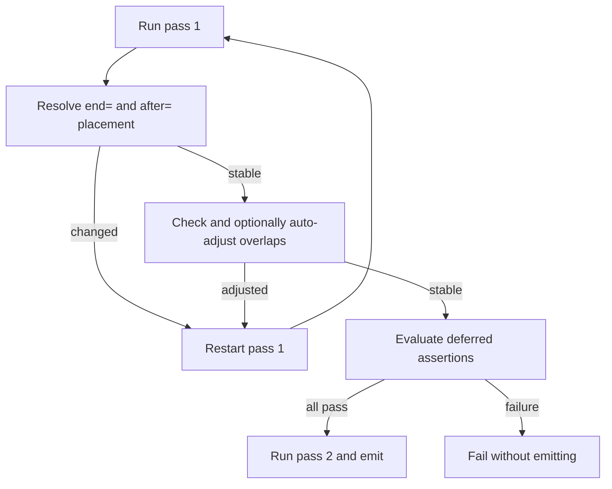

# am65 layout assertions and tooling roadmap

| Field | Value |
|-------|-------|
| Status | **Draft** |
| Author | Codex + Stefan Wessels |
| Date | 2026-09-26 |
| Audience | am65 implementers; a2m/c64m debugger and build-tool owners |
| Product scope | Shared `src/shell/tools/am65/`; both a2m and c64m hosts |
| Intended permanent path | `design/am65/layout-assertions-and-tooling.md` |

## Overview

am65 now has expressions, macros, scopes, named targets, CPU profiles,
end-anchored segments, after-linked chains, auto-adjusted layout, and explicit
reclaimable overlays. The next high-leverage improvement is to let source inspect
and verify the final layout computed by the assembler.

This design proposes **final-layout segment introspection plus assembly-time
assertions** as the next feature:

```asm
.assert sizeof("TITLE") .le $2000, "title image is too large"
.assert endof("CODE") .le $BFFF, "code has entered the BSS area"
.assert startof("BSS") .eq $C000
.assert endof("LOADING_ART") .eq startof("TABLES")
```

It also records four independent follow-ons, in priority order:

1. address-to-source maps for integrated source-level debugging;
2. structured data declarations (`.struct` / `.field` / `.enum`);
3. sliced binary inclusion (`.incbin` offset and length);
4. dependency-file generation for external builds.

Assertions do not require a relocatable object format, a separate linker, or any
of the follow-on features.

## Motivation

Segment layout is implemented in `src/shell/tools/am65/asm.c` and parsed from
`.segdef` in `src/shell/tools/am65/parse.c`. The assembler internally knows every
segment's half-open extent `[segment_start_address, segment_output_address)`, but
source cannot query those values.

Existing layout features express placement and overlap policy:

- `end=addr` derives a start from a fixed inclusive end;
- `after="host"` creates a contiguous chain that moves as a unit;
- `locked` prevents auto-adjust movement;
- `reclaim="host"` creates a bound noemit overlay;
- `reclaimable` plus `overlap_reclaimable` permits independently placed runtime
  storage to overlap disposable emitted contents.

What is missing is a source-level way to state the assumptions those features are
intended to preserve. A build can currently succeed after a code or asset size
change has crossed a program-specific boundary, unless an ordinary segment
collision happens to expose it.

Assertions make that layout self-checking without turning am65 into a linker. The
assembler continues to enforce universal rules such as 64K bounds and illegal
overlap; source assertions enforce program rules such as loader limits, VIC bank
boundaries, reserved firmware areas, or fixed ABI addresses.

## Goals

1. Query the final start, exclusive end, and size of a named segment.
2. Fail assembly with a useful custom message when an invariant is false.
3. Evaluate layout-dependent assertions only after `end=`, `after=`, `.align`, and
   auto-adjust retries have converged.
4. Produce identical behavior in standalone am65, a2m, and c64m.
5. Keep all existing source valid and behaviorally unchanged.
6. Identify the assertion's source file and line in diagnostics.

## Non-goals

- A relocatable object format or separate linker.
- Mutating placement from an assertion.
- Replacing built-in overlap, bounds, reclaim, or chain validation.
- Source-level debugger UI in the first increment.
- Implementing structs, sliced `.incbin`, or depfiles in the assertion change.

## Proposed language

### Segment introspection

Add three expression primitives:

```asm
startof("segment")
endof("segment")
sizeof("segment")
```

| Primitive | Result |
|-----------|--------|
| `startof("n")` | Inclusive final start address of segment `n` |
| `endof("n")` | Exclusive final end address of segment `n`; may be `$10000` |
| `sizeof("n")` | `endof("n") - startof("n")` |

Names use the same case-insensitive matching as `.segment` and `.segdef`. The name
must identify a segment in the active output target. Cross-target lookup is deferred
until there is a deliberate target-qualified naming design.

`endof` is deliberately exclusive because the internal model is half-open. This
makes adjacency natural and represents a segment ending at `$FFFF` without
ambiguity:

```asm
.assert endof("ROM") .eq $10000
.assert endof("A") .eq startof("B")
```

Comparisons use the existing expression operators (`.lt` `.le` `.gt` `.ge` `.eq` `.ne`), not C operators.

In this increment the three queries are legal only inside `.assert`. Pass 2 resets each segment's output address back to its start before emitting, so a query in `lda`, `.word`, `.if`, or `.org` would see a partial or provisional size. A later increment can snapshot the converged extents and allow them in ordinary expressions.

`startof("")` is the unnamed default segment. A segment that exists and contains no bytes has `sizeof` 0; that is a successful query. An unknown name is an error. The same name on a different output target is a distinct error. Lookup uses the target that was active at the `.assert`.

### Assertions

Add:

```asm
.assert expression
.assert expression, "message"
```

A nonzero expression passes. Zero fails assembly. Without a message, emit a generic
`assertion failed` diagnostic (optionally including the expression text). With a
message, emit `assertion failed: message`. The message is a string literal using
existing string escaping rules.

Examples:

```asm
.assert sizeof("TITLE") .le $2000, "title image exceeds its runtime destination"
.assert startof("BSS") .eq $C000, "BSS ABI address changed"
.assert endof("CODE") .le startof("BSS"), "code entered BSS"
.assert (startof("BITMAP") & $1FFF) .eq 0, "bitmap is not VIC-bank aligned"
```

The expression is re-parsed after layout, so it sees final symbol values in the scope that contained the `.assert`, not a loop counter's value at that source line. Assignment, `++`, `--`, the location counter, and anonymous labels are errors. A bare query whose value is 0 fails, because only a nonzero result passes; compare with `.eq` when address 0 is legal.

The optional message uses the same escape decoding as `.string`. The diagnostic is `assertion failed` or `assertion failed: message`. It does not echo the expression text. The file and line are the ones any other diagnostic would report, including a macro body line.

### Explicit diagnostics

`.error "message"` fails assembly at that line. The message is a string literal
using the same escape decoding as `.string`, and the diagnostic text is the
message itself. It is reported on pass 1, at the same file and line as any other
diagnostic, including a macro body line. Assembly then returns before pass 2, so
nothing is emitted. A `.error` in a skipped `.if` is not seen. A missing message,
an empty message, or tokens after the string are pass-1 errors and also emit
nothing.

```asm
.if C64 .ne 1
    .error "This source requires the C64 target"
.endif
```

`.warning "message"` logs a warning. The message uses the same escapes, and the
diagnostic text is the message. It is reported on pass 1 at the usual file and
line, including a macro body. Assembly continues, including layout, assertions,
and pass 2. The result is success when nothing else failed, and output is
written. A skipped `.if` does not see it. A missing message, an empty message,
or tokens after the string are ordinary pass-1 errors.

`ERRORLOG` entries have a severity. Only errors fail assembly. The CLI prints
warnings and errors in separate sections and exits 0 when the log holds only
warnings. Both emulator assembler panels show warnings in the notice dialog.
Messages that already say `Warning:` (search paths and truncated values) are
still errors.

## Evaluation phase

Layout-dependent assertions must not run against provisional pass-1 addresses. An
`end=` or `after=` segment may have several trial starts, and auto-adjust may later
move an entire chain.



During pass 1, `.assert` captures the post-substitution expression text, the
optional message, the source filename and line, and the active scope and output
target. Each pass-1 attempt clears that list first. A layout restart destroys
scopes, so the list from a discarded attempt must not be kept. After convergence
and before pass 2, evaluate the surviving list against the stable segment table.
Deferring even constant assertions keeps the implementation and diagnostic
ordering simple.

Report assertion diagnostics with the pass already set to 2. `ASM_ERR_RESOLVE` is
discarded while the pass is 1, and `asm_err` prints the assembler's current file
and line, so evaluation restores the captured location. On any assertion failure,
return before pass 2. Emitting is pass-2-only, and the emulator hosts write
machine memory from that callback.

Pass 2 must not register or re-evaluate assertions. It performs the existing final
consistency checks and emits only after every assertion has passed. If pass 1
already logged an error, or layout did not converge, skip assertion evaluation.

## Expression integration

`src/shell/tools/am65/expr.c` currently recognizes numbers, symbols, the location
counter, anonymous labels, unary/binary operators, and conditionals. Segment queries
add a function-like primary with a required quoted segment name.

Recommended implementation:

1. Add dedicated handling for the three names in `expr_primary`.
2. Resolve through `segment_find` on the assertion's captured target.
3. Preserve at least a 32-bit value so `$10000` from `endof` survives.
4. Do not implement the queries as text defines; they require final-layout lookup
   and correct output-target ownership.

## Diagnostics and edge cases

| Case | Required result |
|------|-----------------|
| Assertion is zero | Error at the `.assert` source line |
| Assertion is nonzero | No diagnostic |
| Unknown segment | Error naming the segment |
| Zero-length segment | `sizeof` is 0; `startof("")` is the default segment |
| `endof` is `$10000` | Valid expression value (`int64_t`; not truncated to 16 bits) |
| Segment belongs to another target | Error naming that case |
| `startof` / `endof` / `sizeof` outside `.assert` | Error |
| Assignment, `++`, `--`, `*`, or an anonymous label in `.assert` | Error |
| Assertion is in a skipped `.if` branch | Not captured or evaluated |
| Assertion is in an included file | Diagnostic names included file and line |
| Assertion is in a macro | Same file and line as other diagnostics (the macro body) |
| Layout does not converge | Report convergence; do not evaluate assertions |
| An earlier error exists | Do not add misleading assertion failures |
| `.error "message"` | The message is the diagnostic; nothing is emitted |
| `.error` missing, empty, or followed by extra tokens | Pass-1 error; nothing is emitted |
| `.error` in a skipped `.if` | Not reported |
| `.error` in an include or macro | Same file and line as other diagnostics |
| `.warning "message"` | Warning text is the message; assembly succeeds and emits |
| `.warning` missing, empty, or followed by extra tokens | Pass-1 error |
| `.warning` in a skipped `.if` | Not reported |
| `.warning` plus a later `.assert` | The assertion is still evaluated |
| An existing `Warning:` diagnostic | Still an error |

## Testing

Mirror shared behavior in `tests/apple2/tools/` and `tests/c64/tools/`.

Minimum coverage:

1. Passing and failing constant assertions.
2. Custom and default messages.
3. All three queries on an ordinary segment.
4. Exclusive `$10000` end handling.
5. Final values after end-anchor convergence.
6. Final values after an `after=` chain moves under auto-adjust.
7. A reclaimable segment and opted-in noemit BSS.
8. Unknown-segment and wrong-target errors. A zero-length segment queries successfully.
9. Includes, macros, and skipped conditionals.
10. Proof that a failed assertion emits no output.
11. Existing assembler suites and the opcode matrix remain green.
12. `.error`: message text, escapes, no output, skipped conditionals, includes, and macros.
13. `.warning`: severity does not fail the build, output is written, assertions still run, and a warning does not hide a later error.

## Follow-on: source maps and integrated debugging

The largest user-visible follow-on is an address-to-source map emitted alongside
the symbol/segment listing. Record emitted address ranges with source file, line,
and optional scope/procedure. The embedded assembler can publish that map to the
debugger so the current PC and disassembly show the corresponding source line.

This must be a library data product or callback, not frontend code inside the
assembler. Standalone am65 should be able to serialize the same records.

The separate source-map design must settle macro definition versus expansion lines,
include-path normalization, range coalescing, noemit labels/data, and replacement of
old source records after reassembly.

## Follow-on: structured data

Add non-emitting layout declarations that generate scoped offsets and a size:

```asm
.struct Sprite
    .field x, 1
    .field y, 1
    .field color, 1
    .field data, 63
.endstruct

sprites: .res Sprite::size * 8
lda sprites + Sprite::color
```

An `.enum` facility can share the scoped-constant machinery. Macros and ordinary
symbols can approximate this today, so it follows assertions and source maps.

## Follow-on: sliced binary inclusion

Extend `.incbin` without changing its existing one-argument form:

```asm
.incbin "sprites.bin", offset=$400, length=$800
```

Both values must resolve during pass 1, be nonnegative, and remain inside the file.
Report requested and available ranges on failure. Alignment remains the job of
ordinary `.align`.

## Follow-on: dependency files

Standalone am65 should optionally emit Make/Ninja-compatible dependencies for the
root source and every resolved `.include` and `.incbin`:

```text
am65 --depfile game.d -o game.prg game.asm
```

Dependencies use actual resolved paths after relative include and `.search`
processing. This is build integration and should not affect emulator-host assembly.

## Recommended delivery order

1. `.assert` plus `startof` / `endof` / `sizeof` with deferred final-layout
   evaluation.
2. `.error` and `.warning` (landed).
3. Address-to-source map data model and standalone serialization.
4. Debugger consumption of source maps.
5. `.struct` / `.field` / `.enum`.
6. Sliced `.incbin`.
7. CLI dependency files.

The first increment is the key recommendation: it makes the existing layout engine
observable and self-checking while preserving am65's architecture and scope.
